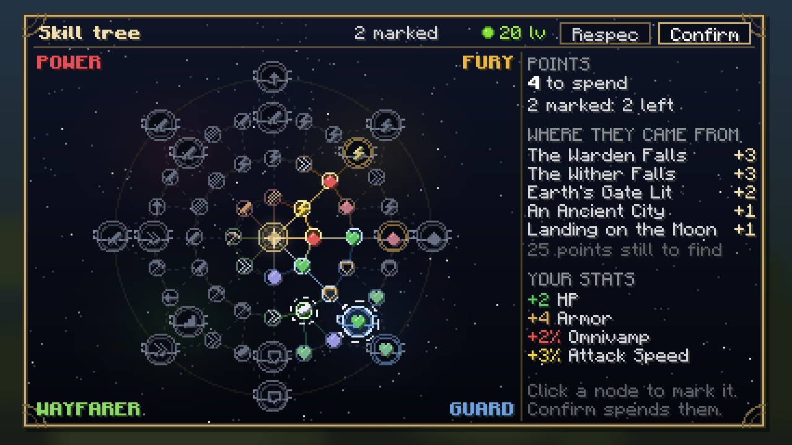

# Player growth

> **Designed 2026-10-15; Sanchit's answers the same day are built in** (§13). Research behind it:
> `growth-research.md`. Structural choices: [ADR-0021](../decisions/0021-player-growth.md).
> Every number here is a placeholder, as in `combat-api.md` §3: Sanchit balances by playing, and
> every number lives in a data file.
>
> **Status, 2026-10-18: merged to `main` ([ADR-0021](../decisions/0021-player-growth.md)), then
> checked together with the runes and the stat system (`client/dev/IntegrationChecks`).**
> **Seen in Sanchit's client on a dedicated server:** the screen (K), marking and confirming nodes, a
> connected path of nine nodes accepted by the server, and the server's live stats matching the tree.
> **Correction:** the "nine points just by exploring" he saw were a data bug, not discoveries. The
> structure discoveries were written `"structure"`, which Minecraft ignores without a word, so the
> condition was empty and every new player was given nine of the v1 budget's 35 points at once. They
> are `"structures"` now, and `tools/check-data.py` (part of every build) fails on the old spelling.
> **Checked by the scripted integration run (49 checks, then 15 after a reload, all passing):** points
> and the tree survive a world reload, a death and respawn (with and without keep-inventory), a real
> respec costs 20 levels and gives every point back, growth is named "Growth" on the stat sheet, and
> the rune page's slots open with the team's milestones.
> **Not yet seen:** a discovery earned by standing in its structure (only that none fire for free),
> boss kills, a gate lit by hand, a second player and late joiners (the shared milestones).
> **Not done:** polishing the node icons (G5), the performance-log reading (G6), and §13 questions 6 to
> 10, built on the first option.

## 1. In short

**Every bit of growth is a skill point, and every skill point is spent in a tree.** Points come
from three places, all permanent and all finite:

1. **Bosses.** The first time the team beats each boss, every player gains 3 points.
2. **Gates.** Each gate lit gives every player 2 points.
3. **Discoveries.** The first time *you* find each notable place, you gain 1 point.

You spend points in a **web** of skill nodes with four themes: Power, Fury, Guard and Wayfarer.
The themes sit side by side and shade into one another, so a player can drift from one into the next
rather than commit to a path. Even HP is a choice, taken in Guard's part of the web. This is where
two players on the same team become different.

Nothing grows from kill counts, time played or vanilla XP, so nothing can be farmed. Growth gives
**numbers**; runes give **behaviours** (§11).

| Source | Who gains it | Points | v1 total |
|---|---|---|---|
| Boss, first kill | The whole team | 3 | 6 bosses: 18 |
| Gate lit | The whole team | 2 | 3 gates: 6 |
| Discovery | You | 1 | 11 places: 11 |
| **Total by the end of v1** | | | **35 points, for a 56-node web** |

## 2. Where it fits

| Layer | Its job | Owner |
|---|---|---|
| **Growth** | The player getting stronger over the game, for good | This page |
| **Armour and items** | Gear: what you carry | The stats session (`item-stats.md`) |
| **Runes** | A swappable build: how you fight | The runes session (`rune-system.md`) |

## 3. Milestones: bosses and gates

**The first time the team beats each boss, or lights each gate, every player gains its points.**
Points only: no stat is given automatically (Sanchit, 2026-10-15).

| Milestone | Where | Points, for every player |
|---|---|---|
| The Warden | Earth | 3 |
| The Wither | Anywhere | 3 |
| The Ender Golem | The Moon | 3 |
| The Ender Guardian | The Moon | 3 |
| The Netherite Monstrosity | The Nether | 3 |
| Ignis | The Nether | 3 |
| Earth's gate lit | Earth | 2 |
| The Moon's gate lit | The Moon | 2 |
| The Nether's gate lit | The Nether | 2 |
| **v1 total** | | **24** |

- **Every boss is worth the same**, so the order a team takes the worlds in never matters
  (ADR-0018).
- **Gates are the mark.** The mark gains a glyph with every lit gate (`the-mark.md`), and now the
  player gains points with it. The voice promises the Heir power as the glyphs fill, and the
  power is real. That is what makes the trap work, so the lore needs no change.
- **What counts as beating a boss:** a kill vanilla credits to a player. That is the last player
  to hurt it in the last few seconds, including by arrow or a tamed wolf. A boss that dies to lava
  or `/kill` with no player behind it gives nothing.
- **A new boss or planet adds a milestone as two data files** (§9), no code.
- **To watch in testing:** with no automatic HP, a player who never takes Guard nodes stays at
  20 HP all game. Armour and items carry their defence. That is the choice Sanchit made; the first
  Warden fight will show whether 20 HP and armour is enough there.

## 4. Discoveries

**The first time you reach each notable place, you gain one point.** Personal: each player finds
them for themselves. One per *kind* of place, not per copy, so the list is finite.

| World | Places (v1) |
|---|---|
| Earth | An Ancient City, Trial Chambers, a Woodland Mansion, an Ocean Monument |
| The Moon | Landing on the Moon, the Lunar Archive, the Ruined Citadel |
| The Nether | Landing on the Nether, the gate ruin in the warped forest, a Nether Fortress, a Bastion |
| **v1 total** | **11 points** |

These use vanilla's own "player is inside this structure" check, which vanilla's structure
advancements already run. **Each place's advancement lives with whatever owns the place**, so none of
it needs another mod loaded:

| Where the file lives | Places | Advancements screen |
|---|---|---|
| `ascension-combat` | The six vanilla places: Ancient City, Trial Chambers, Woodland Mansion, Ocean Monument, Nether Fortress, Bastion | The **Ascension** tab |
| `ascension-worlds` | Landing on the Moon, the Lunar Archive, landing on the Nether, the gate ruin | The **Gateways** tab |
| `ascension-compat-cataclysm` | The Ruined Citadel, and the four bosses | The **Ascension** tab, only with Cataclysm |

Landing on the Moon or the Nether is a "you are
in this dimension" check, so it also counts a player who logs in or respawns there.

## 5. The skill tree

> **Reshaped 2026-10-17.** The first version was four arms, each a corridor you chose and walked
> down. Sanchit: it should be more entangled, "a player should not feel to go in a direction instead
> he should be able to go to adjacent areas". It is now a web.

### Shape

**Round a centre emblem there are four rings of nodes, like the dials of an orrery.** Every node touches
its neighbours on its own ring and on the rings either side, so there is never one way to go. A player
can start almost anywhere, step sideways into the next area for one point, and reach a strong node by
several routes.

| Theme | Stats | Where |
|---|---|---|
| **Power** | Attack Damage, Lethality, Penetration | The top-left corner |
| **Fury** | Attack Speed, Omnivamp, Move Speed | The top-right corner |
| **Guard** | HP, Armor, Magic Resist | The bottom-right corner |
| **Wayfarer** | Move speed, mining speed, reach, safe falls, step height | The bottom-left corner |

Between each pair of themes is a sector that mixes the two, at the top, right, bottom and left
(Power and Fury, Fury and Guard, Guard and Wayfarer, Wayfarer and Power). Nodes there, and nodes on
the line between two sectors, take their stat from either side, so the web reads Power, Fury, Guard,
Wayfarer all the way round and the themes shade into one another. A node's colour is its first stat's
theme; nothing else depends on it.

Power pairs naturally with Reaver runes, Fury with Vanguard, Guard with Bulwark, but nothing ties
them: any region works with any rune page. Wayfarer is Ascension's own: the planets are the game, and
surviving them is a direction worth choosing.

| Ring | Nodes | What is on it |
|---|---|---|
| **1** | 8 | **Start nodes**, touching the centre: one for each sector, so a player begins in any theme |
| **2** | 16 | Eight on the spokes, and eight between them that bridge two sectors |
| **3** | 24 | A **notable** on each of the eight spokes, and a small node either side of it |
| **4** | 8 | A **capstone** on each spoke, reached from the notable below it or from either side of it |

Each ring is a closed loop, and the rings are joined by spokes and by the extra links between
sectors, so most nodes touch three or four others.

### Rules

- **Every node costs 1 point.** You can take a node if it is a start node, or **next to one you have**.
  A link works both ways: next to means joined, whichever way the file names it.
- **Two kinds of node:** small (worth 1 unit, §8), and notable (named, worth about 4 units; the
  capstones about 6). There are 16 notables: eight on ring 3, three points from the centre by the
  shortest route, and eight capstones on ring 4, four points out.
- **v1: 56 nodes.** With 35 points a player takes a little over half the web, about 62%. They choose
  which half: all of one side, a ring round the whole centre, or a path out to a capstone and back
  along another. Each new world adds nodes to the outside of the web, as data, so there is always
  more tree than points.
- **Respec: anywhere out of combat, for 20 XP levels** (Sanchit, 2026-10-15). All points come back
  to spend again. A respec moves points; it never makes them. Free in creative mode.
- **The tree never holds procs or on-hit effects.** That is the runes' job (§11).

### v1 content (placeholders)

Small nodes: one stat each, a unit's worth.

| Theme | Small nodes |
|---|---|
| **Power** | Might +0.25 Attack Damage, Edge +2 Lethality, Piercing +2% Armor Pen |
| **Fury** | Tempo +3% Attack Speed, Hunger +1% Omnivamp, Swiftness +2% Move Speed |
| **Guard** | Vitality +1 HP, Plating +4 Armor, Warding +4 Magic Resist |
| **Wayfarer** | Pace +2% Move Speed, Delving +15% mining speed, Long Arm +0.5 reach, Soft Landing +1 safe fall |

Notables, round the web (the top is Power and Fury, and so on clockwise):

| Where | Ring 3 notable (3 points out) | Ring 4 capstone (4 points out) |
|---|---|---|
| Top (Power and Fury) | **Rampage:** +0.5 Attack Damage, +6% Attack Speed | **Sunder:** +8% Armor Pen, +8% Magic Pen |
| Top right (Fury) | **Frenzy:** +12% Attack Speed | **Whirlwind:** +18% Attack Speed |
| Right (Fury and Guard) | **Bloodthirst:** +4% Omnivamp | **Lifeblood:** +3% Omnivamp, +4 HP |
| Bottom right (Guard) | **Stout Heart:** +4 HP | **Unbroken:** +6 HP |
| Bottom (Guard and Wayfarer) | **Bastion:** +8 Armor, +8 Magic Resist | **Ironwalk:** +4 Armor, +4 Magic Resist, +3% Move Speed |
| Bottom left (Wayfarer) | **Sure Foot:** step height to a full block | **Pioneer:** +6% Move Speed, +2 safe fall |
| Left (Wayfarer and Power) | **Trailblazer:** +4% Move Speed, +0.5 Attack Damage | **Pathbreaker:** +0.75 Attack Damage, +6% Move Speed |
| Top left (Power) | **Heavy Hand:** +1 Attack Damage | **Executioner:** +1.5 Attack Damage |

**The whole web would give** (all 56 points, which nobody has): +18 HP, +24 Armor, +20 Magic Resist,
+5.5 Attack Damage, 8 Lethality, 10% Armor Pen and 8% Magic Pen, +54% Attack Speed, 10% Omnivamp,
+29% Move Speed, +60% mining speed, +0.5 reach, +4 safe fall and a full-block step. With 35 points a
player has about 62% of that, which is what makes the choice real.

- **Deep Lungs** needs `ascension-atmosphere` to read a lung-capacity attribute (§11, §13 question
  7). Until that is decided it is not in the data; if Sanchit wants oxygen in the tree it is one more
  node file on the Wayfarer side.
- **Sure Foot** is vanilla's step-height attribute raised to one block.

### As built

- Nodes are `data/ascension_combat/ascension_combat/growth_node/web/*.json`, named by ring and
  direction: `r1_n` is ring 1 at the top, `r2_n_ne` the bridge on ring 2 between the top and top-right
  sectors, `r3_se_l` the small node counter-clockwise of the bottom-right notable `r3_se`, `r4_se` its capstone.
- A node file has `"start": true` if it touches the centre, `links` to its neighbours (named once, on
  either end), and a `position` in ring steps from the centre (`[0, -1]` is one step up).
- Nothing reads `arm` but the screen, which uses it for colour.
- The server log says when a node can never be taken, and the build fails if the data has a dead
  end, a node with no way in, a theme with no start, or themes that are not joined to each other
  (`GrowthTreeDataTest`).

## 6. Why none of it can be farmed

| Source | Why it can't be farmed |
|---|---|
| Bosses | First kill only. Killing the Wither ten times gives 3 points, once. |
| Gates | Once each, and a lit gate stays lit. |
| Discoveries | Once per kind of place, not per copy. A hundred Ancient Cities give one point. |
| The tree | Points come only from the three above. A respec moves points, never makes them. |
| Death | Nothing is lost, and nothing is gained. |
| Co-op | A shared milestone is earned once per team. Five players do not make it five times. |

Turned down, from `player-power.md` and the research: kill-XP and activity levels (machines farm
them), vanilla XP levels (spent on enchanting), endless paragon levels (a treadmill).

## 7. Co-op and late joiners

**Decided (Sanchit, 2026-10-15): bosses and gates go to the whole team.**

- **Shared: bosses and gates.** When one happens, every player on the team gains its points:
  those online now, and anyone who joins later, on their first login. **Teams (ADR-0023, built
  2026-10-18, [`teams.md`](teams.md)):** "the team" is whatever `core`'s `TeamRegistry` says, the whole
  server when no team mod is installed (as before). Each team has its own set of earned milestones
  (`TeamGrowthState`), a boss's points go to the killer's team, and joining a team makes the player and
  the team hold the union of their milestones. Gates stay the world's (`ascension-worlds` awards them
  to everyone). A world saved before teams reads as the whole server's set and every new team starts
  with a copy of it. Seen: the saved old format loads, and the team events award both ways, with no
  team mod, in the scripted run. Not yet seen: two real teams.
- **Personal: discoveries and the tree.** The team shares the points; each player spends theirs
  in their own direction. In a team of three, one can be the tank, one the striker, one the
  explorer.
- **A late joiner arrives with the team's points, unspent.** Their first act is choosing a
  direction. That closes the growth half of `todo.md`'s late-joiner gap. The gear half stays, as
  ADR-0018 already says.

## 8. The numbers, sized against items

### One yardstick

So the stats session can price items against growth, everything is measured in **units**. One
small node, one point, is one unit.

| 1 unit is about | 1 HP | 4 Armor | 4 Magic Resist | 0.25 Attack Damage | 3% Attack Speed | 1% Omnivamp | 2 Lethality | 2% Penetration | 2% Move Speed |
|---|---|---|---|---|---|---|---|---|---|

Rough reasoning: at 30 HP, +1 HP is about 3% more survival, and +0.25 Attack Damage on a diamond
sword (7) is about 3.6% more damage.

### A fully grown v1 player

35 points: about 35 units, plus a little more for each notable reached.

The whole web is 56 points and gives the totals in §5, so a player with 35 has about 62% of it. What
they have depends on where they went:

- **A defender** takes the Guard corner and the sectors beside it, and runs a ring round to Fury for
  Omnivamp: most of the web's HP, Armor and Magic Resist, plus some healing.
- **A striker** takes Power and Fury: most of the Attack Damage, Lethality, Penetration and Attack Speed,
  with little HP.
- **An explorer** takes Wayfarer and a lean into Guard or Power: the move, mining, reach and fall
  stats, and a full-block step.

No one has all of it, and the paths cross, so two players with the same points are rarely the same.

### Base or bonus: neither

**There is no base/bonus split** (the stats session, `item-stats.md` §6, Sanchit 2026-10-15). A
stat is one total, and items scale off the total. Growth adds to that total, so every point a player
puts into Power also makes their items hit harder. That is what Sanchit's answer "bonus" asked for,
and his "these stats will be used in the items' scaling as well".

### For the stats session (through Sanchit)

- **Growth's modifiers carry the prefix `ascension_combat:growth/`**, which growth registers with
  `StatSources` as "Growth" once that API lands (their increment 2).
- **A legendary item's raw stats ≈ 8 to 10 units**, about the growth from two or three bosses
  (`player-power.md` §3.3). For example +2.5 Attack Damage, or +10 HP, or +40 Armor, before its
  effect.
- **Growth and items end up about even.** Items should carry most of a player's damage; growth
  is how a player chooses what kind of fighter to be.

### The hearts on screen

A Guard player reaches about 35 HP, under two rows of hearts, which vanilla draws fine. A health
bar with a number (`player-power.md` §3.5) can wait until real numbers pass that.

## 9. Storage and sync

### Milestones are advancements

**Every milestone is a vanilla advancement.** Vanilla already keeps advancements per player, saves
them with the world, sends them to the client, shows a toast and lists them on the advancements
screen. Other mods and datapacks can add advancements with plain JSON, and any mod can check one.

- **Bosses:** an advancement using vanilla's `player_killed_entity` trigger. No code.
- **Discoveries:** vanilla's `location` trigger with a structure or dimension. No code.
- **Gates:** `ascension-worlds` awards `ascension_worlds:gates/<planet>` when a gate lights,
  to every player online and to anyone who joins later (`GateAdvancements`, called from
  `GateProgress`, which already tells every client when the network changes). The path is the
  planet's dimension path (`overworld`, `moon`, `the_nether`), with its namespace added for a planet
  from another pack. This is how a gate reaches growth without either module knowing the other
  (ADR-0011): the advancement is the shared language.

**Where a milestone's files live.** A growth file is a datapack registry entry, and a namespace
may add to any registry, so **the milestone file lives in the module that owns the boss, gate or
place**, next to its advancement: `data/<namespace>/ascension_combat/growth_milestone/...`. Without
`ascension-combat` that folder is never read, so `worlds` and `compat-cataclysm` carry growth
files that do nothing on their own and need no condition. Only an advancement whose parent is
Ascension's root needs `neoforge:conditions` (mod loaded: `ascension_combat`), which the Cataclysm
ones have. A new planet's pack therefore adds its gate, its places and what they are worth, with no
change to combat.

A growth file then says what an advancement is worth, in
`data/ascension_combat/ascension_combat/growth_milestone/warden.json`:

```json
{
  "advancement": "ascension_combat:growth/warden",
  "shared": true,
  "points": 3
}
```

And a tree node, in `data/ascension_combat/ascension_combat/growth_node/web/r3_se.json`:

```json
{
  "arm": "guard",
  "kind": "notable",
  "name": { "translate": "growth.ascension_combat.node.stout_heart" },
  "position": [2.121, 2.121],
  "links": ["ascension_combat:web/r2_se", "ascension_combat:web/r3_se_l"],
  "stats": [
    { "attribute": "minecraft:generic.max_health", "amount": 4 }
  ]
}
```

A node touching the centre adds `"start": true`.

- **Stats name any attribute by id**, vanilla's, ours, or another mod's. An attribute that isn't
  installed is skipped, with one log line. So growth can raise oxygen (an `atmosphere` attribute)
  without depending on `atmosphere`.
- **Percent stats** take `"operation": "add_multiplied_base"`, as vanilla's own modifiers do.
- **Both are datapack registries, sent to clients**, the same way `archive_entry` is. The tree
  screen draws from them.

### What is stored

| What | Where | Saved? |
|---|---|---|
| A player's milestones | Vanilla advancements | Yes, by vanilla |
| A player's taken nodes | A player attachment, `growth` | Yes, and kept through death |
| The team's shared milestones | An attachment on the Overworld, like the gateway network | Yes |
| Points and stats | Nowhere: worked out from the three above | No |

**Nothing is added up and stored.** Points and stats are worked out again from the player's
advancements and nodes whenever something changes, so a total can never drift from what earned it,
and a node removed from the data gives its point back. Growth's own files are datapack registries,
which load at server start, as planets and archive entries do: a change to one needs a restart.
Advancements reload with `/reload`. The server log checks the data at every start and reload: a
milestone naming a missing advancement, a link to a missing node, or an attribute that isn't
installed is reported, not silently skipped.

### Applying stats

- **One attribute modifier per attribute and operation**, with ids `ascension_combat:growth/add_value`
  and `ascension_combat:growth/add_multiplied_base` (and `add_multiplied_total`, unused so far).
  Worked out again and replaced, never stacked.
- **Permanent modifiers**, saved with the player: their saved attributes load before their health, so
  max HP from growth is in place before a reloaded player's health is read.
- **When:** login, respawn, an advancement earned or revoked, nodes taken, a respec, `/reload`.
- **Gaining max HP heals the difference**, so a new heart arrives full.
- **On respawn**, the new body gets its modifiers first, then full health.

### Sync

- **Stats** sync themselves: max HP is vanilla's, and every combat attribute is already syncable.
- **The screen's state:** one payload with the taken nodes and points earned and spent, sent at
  login and on any change. Never per tick.
- **From the client:** a payload with the nodes taken in one go (on confirm), and one for a respec.
  The server checks every rule and ignores anything that breaks one.

### Performance (ADR-0007)

- **Nothing ticks.** Working out growth is about a hundred small sums, and only on the events above.
- **Discoveries** ride vanilla's own location check, about once a second per player and only for
  criteria not yet earned, the same check vanilla's structure advancements already run.
- **No static collection holds a player.** The team state lives on the Overworld; the client's copy
  is cleared on logout.

## 10. The screen

**Opened with K** (bound by default, so players find it).

**Built 2026-10-17, from the approved mockup; not yet seen in a client.** `client/GrowthScreen` draws
the web from the synced `growth_node` registry, with the textures `tools/generate-growth-art.py`
writes (`textures/gui/growth/panel.png` and `nodes.png`, laid out in `GrowthSprites`). Click marks a
node and clicking again unmarks it (`GrowthSelection`, the server's own rules run over what is taken plus
what is marked); Confirm sends the marked nodes in one `GrowthTakePayload`; Respec asks "Sure?" for three
seconds before it sends. The side panel reads the server's `GrowthSyncPayload` snapshot, so the screen
never guesses. It is drawn at 400 by 224 and shrunk, never grown, to fit a small window.

- **The tree in the middle:** the centre emblem, and the web of rings round it, each node in the
  colour of its theme. Small nodes are round sockets; notables are larger and framed. Taken nodes glow,
  nodes you can take pulse softly, the rest are dim. Drag to pan if the tree is bigger than the screen.
- **Hovering a node** shows a card: its name, what it gives in numbers, and whether you can take it.
- **Taking nodes is two steps:** click to mark, then confirm. Nothing is spent until you confirm,
  and you can unmark before then.
- **A side panel:** points to spend, and **where your points came from**: each milestone and
  discovery earned, with how many points it gave. Milestones not yet earned show as goals, unless
  they are secret. Below that, your totals by stat.
- **A respec button**, greyed out in combat or without 20 XP levels, and asking you to confirm.
- **A toast** when you gain a milestone: "The Warden: 3 skill points".
- **Motion and sound:** a line fills in from the node you came from; a soft chime on taking a node,
  a deeper one on confirm.
- **Readable at GUI scales 2 to 4.**
- **The same game as the rune screen:** the same frame, palette, card style and sounds. Mockups
  first, from a seeded script as the art guide says, sent to Sanchit before any screen is built.

### The mockup (2026-10-17, approved by Sanchit)



Made by `tools/generate-growth-art.py` from the real node files, so it shows the tree as built. The
hover card is `design/growth/tree-hover.png`; the fit at GUI scales 2 to 4 is
`design/growth/tree-fit-gui-scales.png`. **The first mockup was four diagonal arms and Sanchit turned it
down as too narrow; this is the web that replaced it.** It shows a player who started in Guard, walked
round the first ring into Fury, and has two more nodes marked.

- **A web of rings in the rune screen's kit:** the night sky in a brass frame, round sockets, the same
  buttons and cards. All 56 nodes fit one screen with no panning, with the themes in the four corners
  (Power top left, Fury top right, Guard bottom right, Wayfarer bottom left). A longer web, from future
  worlds, will need dragging to pan.
- **Theme colours** follow the rune paths they pair with: Power red (Reaver), Fury gold (Vanguard),
  Guard blue (Bulwark), Wayfarer green. Each node's icon is its first stat, in the colour the cards use for it
  (HP green, Armor tan, Magic Resist lavender, Attack Damage orange). Links take the blend of their two ends.
- **Four states, told apart by more than colour:** *taken* is a bright star in a halo; *can take* is a
  ring of starlight; *marked, not confirmed* has a dashed white ring; *not reachable yet* is a dim ring.
  Notables are larger, with a second ring and an orbit.
- **The side panel:** points to spend (and what the marked nodes leave), where the points came from, the
  goals still to find, and your stats.
- **The centre** is a neutral four-pointed star for now: question 9 (the mark, or neutral).
- **The icons are placeholders** drawn to read at a glance; polishing them is G5.
- **The art kit is a copy** of the runes session's helpers (`tools/generate-rune-art.py`, in its
  worktree), so the two screens match now. When the runes work merges, the copy should become an import
  of one shared module.

## 11. Working with the other sessions

**Stats (prompt 1).** Requests, through Sanchit:
1. **Growth registers `ascension_combat:growth/` with `StatSources`** as "Growth" once that API
   lands. Nothing else is needed: there is no base/bonus split (§8).
2. **No new combat stats needed.** Growth uses HP, Attack Damage, Attack Speed, Move Speed, Armor,
   Magic Resist, Omnivamp, Lethality and Penetration as they exist. Wayfarer uses vanilla
   attributes (movement speed, block break speed, safe fall distance, step height, block reach).
3. **The character sheet** could show each stat's growth share, if the API reports it.

**Runes (prompt 2).**
1. **The boundary:** growth is numbers and permanent; runes are behaviours and swappable. The tree
   never gets procs; runes never give permanent stats.
2. **If runes unlock with growth,** a rune's unlock can name an advancement (any mod can check one)
   or a number of milestones, read through `com.ascension.combat.api.growth`. To be agreed through
   Sanchit.
3. **Visual language:** the tree screen will use the rune screen's frame, palette, cards and sounds
   once its mockups are approved, rather than invent a second look.

**Atmosphere (not a parallel session).** For Deep Lungs: atmosphere registers a lung-capacity
attribute in its own api and counts it alongside its `LungCapacityModifier` registry. Small, and
only if Sanchit wants oxygen in the tree (§13, question 7).

## 12. Build order

Each step is checked in Sanchit's client, and on a dedicated server, as ADR-0008 asks. The screen
comes last, so the rules underneath are proven first with a debug command.

| Step | What | How it is checked |
|---|---|---|
| **G1** | The data and the rules: both registries, the player and team attachments, the stat modifiers, an Ascension advancement tab, the Warden and Wither milestones, the Guard arm's nodes, the respec rule, and a command (`/ascension growth`, `take <node>`, `respec`) | Dedicated server: kill the Warden, see the toast and 3 points. Take two Guard HP nodes: 22 HP. A second client joins and has 3 points too. Restart the server: still 22. Die: respawn at 22, full. |
| **G2** | Every source and every node: the gates (`worlds` awards their advancements), Cataclysm's four bosses (`compat-cataclysm` data), the discoveries, and the other three arms. **Built 2026-10-17**, not yet seen in a client | Each source earned in a client, totals on the command. |
| **G3** | Refactor pass (ADR-0008) | No new features. |
| **G4** | The screen, working: the tree, cards, taking and confirming, the side panel, the respec button, the toast. **Mockup approved 2026-10-17; screen built, not yet seen in a client** | Take nodes from the screen, confirm, see the stats. Reload the world: still taken. |
| **G5** | The screen's art, once Sanchit has approved a mockup | Seen at GUI scales 2, 3 and 4. |
| **G6** | Refactor pass, and a reading in `performance-log.md` | Heap and tick time before and after. |

Growth adds no items in v1, so the resource ledger is unchanged.

## 13. Decisions

**Answered by Sanchit, 2026-10-15:**

1. **Co-op:** bosses and gates go to **the whole team**, including people who join later.
2. **What a milestone gives:** **skill points only**, about 3 per boss and 2 per gate. No stat is
   given automatically.
3. **Directions:** **a skill tree.** First built as four arms; on 2026-10-17 Sanchit said it should be
   "more entangled", so it is **a web** (§5), where a player can move into any adjacent area.
4. **Respec:** **anywhere out of combat, for 20 XP levels.**
5. **Base or bonus:** growth counts as **bonus**. The stats session then settled that there is no
   split at all: growth adds to the one total items scale off, which gives the same result.

**Still open.** Until Sanchit says otherwise, the build follows the recommendation, which is listed
first:

6. **Advancements:** show milestones as **an Ascension tab on the advancements screen, with
   toasts**? Or keep them hidden?
7. **Oxygen:** should the Wayfarer side grow your lungs (a small `atmosphere` change), or leave
   oxygen to gear? Deep Lungs stays out of the data until this is answered (one more node on the Wayfarer side).
8. **Where the code lives:** **in the combat module, `internal/growth`**, as the session prompt
   said? Or a module of its own (`ascension-progression`, already on the architecture map)?
9. **The tree's centre:** the mark (the glyphs and the eye), or a neutral emblem? Needed by G5.
10. **Later ideas:** relics in handcrafted sites, claimed once per player, and the Archive's tablets
    granting points. **Later**, or now?

> **On the HUD (2026-10-18):** unspent skill points show as a small gold note above the health row, with the key that opens the tree; see `docs/technical/hud.md`.
