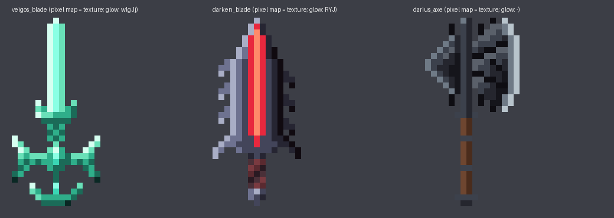
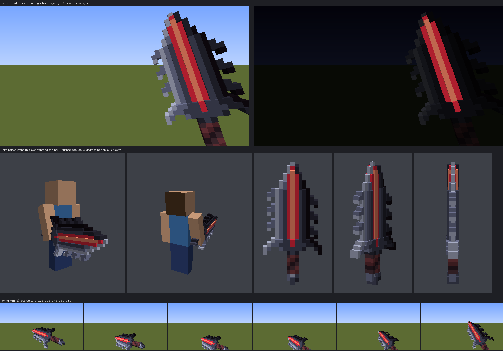
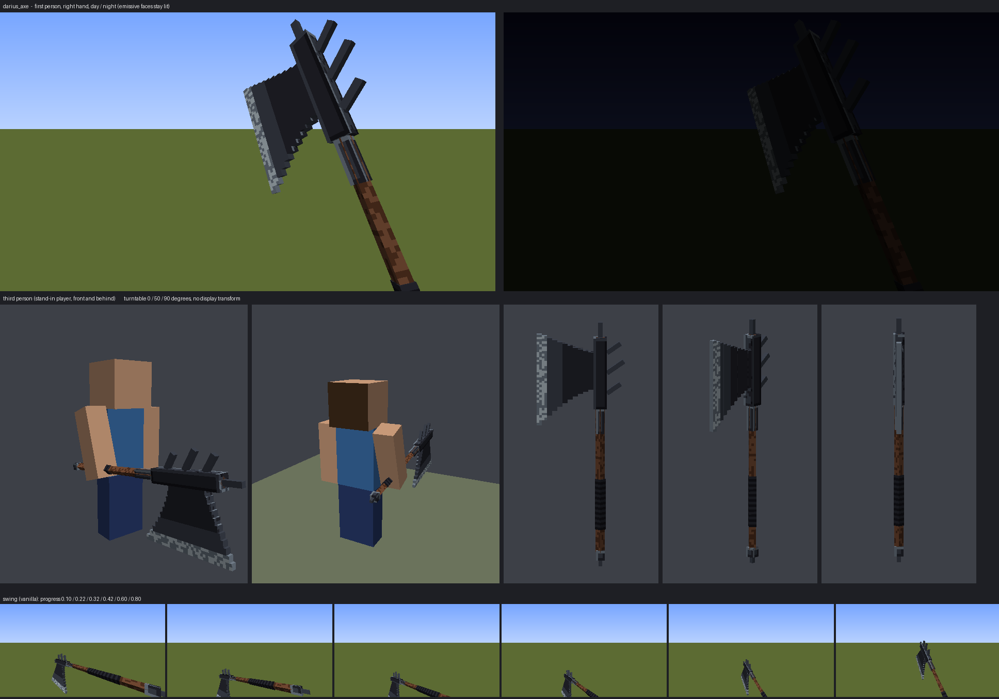

# Combat items — art

**Status:** art, 2026-10-07: sprites and worn armour (first pass), then 3D in-hand models for
three weapons (see [3D in-hand models](#3d-in-hand-models); **rejected by Sanchit on review, to be
redone**, see `plans/combat-art-3d.md`). **Not yet seen in a running client**
(ADR-0008). The module builds and the generators reproduce every PNG byte for byte, but nobody
has held these items, drawn the bows or worn the armour in game.

| | |
|---|---|
| Generators | `tools/generate-combat-art.py` (sprites, worn armour, item models), `tools/generate-combat-models.py` (3D in-hand models); hand-placed pixel maps, rerun them, never edit a PNG |
| Previews | `design/combat-items/icons.png` (every sprite, plus the bows' draw frames), `worn.png` (each armour piece on a figure), `3d/` (each 3D model in hand, from `tools/render-item-model.py`) |
| Brief | [`combat-art-reference.md`](combat-art-reference.md): what each League item looks like, and Sanchit's answers |
| Method | [`art-guide.md`](art-guide.md) |
| Next | [`plans/combat-art-3d.md`](../../plans/combat-art-3d.md): where the track stands, and the 3D model plan |

Every combat item now has its own art in place of borrowed vanilla gear: 25 sprites at 16 × 16,
three draw frames per bow, a flat inventory icon for Veigo's Blade, and **its own worn look for
every armour piece**.

**Likeness, our pixels.** These are ported League items and Sanchit wants them to look like
their League counterparts (2026-10-06; a first, "original-styled" round was rejected). Each
sprite keeps its source's silhouette, palette and one or two signature details. Every pixel is
placed by hand in the generator's pixel maps: nothing is traced, sampled or scaled down from
Riot's images. The reference screenshots live in `design/reference/league/`, which git ignores.

## Sanchit's calls (2026-10-07)

| Question | Answer |
|---|---|
| Darius's Axe | the **Black Cleaver** |
| Ninja Tabi | today's **Plated Steelcaps** |
| Wizard's Agony | **Spellslinger's Shoes** (Sorcerer's Shoes' tier 3) |
| Tasted Blood | **Gluttonous Greaves** (a 2026 boots item, Aatrox's quote) |
| 2D or 3D | **16 × 16 first**, 3D in-hand models later |
| Worn armour | **changes too**: each piece looks like itself on the body |
| Who draws | **this session**: models, animation and item art are made outside the combat session and merged back |

## What each one is

| Item | League source | What the sprite keeps |
|---|---|---|
| `veigos_blade` | Viego's sword | long narrow jade blade, the two crescent guard arms, crescent pommel, diamond socket; glows |
| `darken_blade` | Aatrox's Darkin Blade | broad dark blade, saw teeth on both edges, a glowing crimson channel, swept guard |
| `darius_axe` | Black Cleaver | a huge near-black double-bit head, spiked edges, cracked plates, polished lower edge, wooden haft |
| `endless_hunger` | Endless Hunger | one of the icon's black crescent sickles: gold outer edge, glowing crimson inner edge |
| `ragefang` | Guinsoo's Rageblade | flame-tongued orange-gold blade with a red core; the tongue tips glow |
| `spear_of_shojin` | Spear of Shojin | the lime-jade dragon-claw blade on a gold collar, long haft |
| `wraithblade` | Youmuu's Ghostblade | silver blade with a dark fuller, broad gold crossguard round a glowing violet gem |
| `divine_sunderer` | Divine Sunderer | gold half-moon head with an emerald inlay arc, navy shaft |
| `mortal_reminder` | Mortal Reminder | steel bow with saw spikes, gold bands, a purple grip |
| `heartwood_of_pallas` | Varus's bow | dark violet chitin, glowing magenta spots and a lilac core at the grip, a claw at the grip |
| `galeforce` | Galeforce | silver-white bow, swept blade fins at the tips, cyan at the grip |
| `protean_mask` | Jak'Sho | a spiky void-purple mask, glowing red eyes and cracks |
| `edge_of_night` | Edge of Night | an indigo hood, a dark face, two faint glowing eyes |
| `gargoyle_stoneplate` | Gargoyle Stoneplate | a pale stone cuirass with broad pauldrons, glowing gold cracks |
| `guardian_wing` | Guardian Angel | a gold breastplate, white wings at the shoulders, a glowing cyan crystal |
| `rocketbelt` | Hextech Rocketbelt | the belt itself: two gold rocket cones, a blue crystal buckle, glowing blue exhaust jets |
| `collectors_pants` | The Collector | dark gunmetal with gold filigree (League's icon is a gun) |
| `unending_despair` | Unending Despair | green-black spiked carapace with glowing cyan veins and core |
| `mercury_treads` | Mercury's Treads | brown leather, steel cuff, toe cap and sole, a gold-set sapphire |
| `ninja_tabi` | Plated Steelcaps | layered steel plates and studs over olive cloth |
| `swifty` | Boots of Swiftness | a cream boot, white fur cuff, feathers at the heel |
| `berserkers_greaves` | Berserker's Greaves | a steel greave over a brown boot, crackling yellow lightning |
| `wizards_agony` | Spellslinger's Shoes | a navy boot with gold bands and a silver plate, a spiked orb at the toe, a violet aura |
| `tasted_blood` | Gluttonous Greaves | a bone-white boot with a jagged crest, a crimson streak, a fanged maw at the toe |
| `zonias_hourglass` | Zhonya's Hourglass | a gold frame round an hourglass, glowing amber sand mid-fall |
| `steraks_harness` | Sterak's Gage | a steel gauntlet with lilac sheen, long pale claws, a crimson band at the wrist |

`test_magic_blade` is a `/give`-only test item and keeps the vanilla look.

## How it is wired

- **Swords** use `minecraft:item/handheld`; armour and off-hand items use `item/generated`.
- **Glow.** A sprite's glowing pixels (gems, crystals, glowing channels, auras) are cut out of
  `<id>.png` into `<id>_glow.png`, drawn as layer 1 by NeoForge's `neoforge:item_layers` loader
  with `neoforge_data` full-bright (block and sky light 15, unshaded). So they stay lit in hand
  at night. In the inventory everything is full-bright anyway.
- **Bows** have four textures: idle and `_pulling_0..2`. The body is one pixel map, and the
  string and arrow are drawn per frame in vanilla's layout (arrowhead toward the top left). The
  models keep vanilla's bow transforms and `pull` thresholds.
- **3D in hand:** Veigo's Blade, the Darkin Blade and the Black Cleaver (`HELD_3D` in
  `generate-combat-art.py`). `<id>.json` is a `neoforge:separate_transforms` wrapper: the 3D
  `<id>_3d.json` in hand, the flat `<id>_icon.json` sprite in the inventory, on the ground and in
  item frames, where a 3D model reads as a thin line. See [3D in-hand models](#3d-in-hand-models).
- **Worn armour.** Each armour item has its own `ArmorMaterial` (`CombatContent.armor`): diamond's
  numbers, **copied rather than restated so no stat changes**, plus a layer texture
  `textures/models/armor/<id>_layer_1.png` (helmets, chestplates, boots) or `_layer_2.png`
  (leggings). One material per item, because each is its own League item, not one piece of a
  set. Each texture paints only the boxes its slot renders, so a Jak'Sho helmet and Mercury's
  boots worn together don't fight over the same pixels. That's the only Java this batch touches.

## 3D in-hand models

**Added 2026-10-07:** Veigo's Blade (a full redo of the 373-cuboid Blockbench model), the Darkin
Blade and the Black Cleaver. The plan was [`plans/combat-art-3d.md`](../../plans/combat-art-3d.md).

**How they are made.** `tools/generate-combat-models.py` draws each weapon as an upright front
view, typed in as a pixel map like the sprites (one model unit per pixel, up to 32 tall, centred
on x = 8, z = 8). Every symbol has a colour and a thickness, and the model is that picture
extruded: thin bevelled edges, a raised ridge, thick guards, a bulging jewel, sunk channels and
seams. Neighbouring cells of one thickness merge into one cuboid (43–65 per weapon, against the
old Veigo's 373). The pixel map is also the 32 × 32 texture: south faces show their rectangle,
north faces its mirror, side faces stretch their edge texel. Side faces are only made where a
neighbour is thinner. Glowing pixels get their own cuboids with element `neoforge_data` (block
and sky light 15), so they stay lit at night. Palettes are imported from the sprites in
`generate-combat-art.py`, so icon and model can't drift.

| Model | What it keeps from League | Glows |
|---|---|---|
| `veigos_blade_3d` | Viego's sword hilt to tip: anchor pommel, glowing socket, a crescent great guard round a bulging jewel, short wrapped grip, horned small guard, long narrow blade; bright jade | the whole blade, the jewel and socket |
| `darken_blade_3d` | Aatrox's sword: broad gunmetal blade bevelled to thin edges, hooked barbs raking back on both edges, a sunk crimson channel with a hot core, a guard swept into spikes, long maroon grip, spear-point pommel | the channel and its core, the guard's centre |
| `darius_axe_3d` | Black Cleaver: a main bit flaring to a broad, convex polished edge, near-black plates split by sunk seams fanning from the haft, black thorns top and bottom, a dull back bit, a long banded brown haft | nothing (it isn't magic) |

**Departures from the reference.** Viego's great guard arms are offset like an S in his render;
at 15 pixels wide that read as a tangle of hooks, so they are level here. The Darkin Blade's barbs
and guard spikes are simplified to a repeating tooth.

**Display transforms.** Third person is vanilla's handheld transform turned 45° for a model drawn
upright instead of diagonal (an exact fold into the Z rotation, since `ItemTransform` is
`T · Rx · Ry · Rz · S`), then moved so the weapon's grip lands where vanilla's handle is
(`upright_handheld()`). First person is not: at 32 pixels tall, vanilla's diagonal pose juts out
of the right of the view. All three instead stand upright at the right of the view, face on, with
the guard in sight at the bottom. Vanilla's swing turns that into a forward chop for the Darkin
Blade and the Cleaver; Veigo's Blade keeps `VeigosBladeClient`'s wind-up, cut and recovery (the
swing strip in its preview). Both hands take the same values; the game mirrors them for the left.

**Veigo's old first-person values were not what the old screenshot shows.** The committed
`[0, -25, 35]` with `[1, -3, -3]` puts the great guard below the bottom of the view.
`design/weapons/viegos-blade/first-person.png` (2026-09-09, also `13` in the references)
predates those values; fitting it gives almost exactly vanilla's `[0, -90, 25]` rotation. So
those values were never seen in game, and the new pose replaces them rather than keeping them.

**Previews** come from `tools/render-item-model.py`: first person by day and by night, a stand-in
player from two sides, a turntable and the swing, through the game's own transform chains and
item lighting (checked against the 1.21.1 sources). Lighting there is fixed for a player facing
north; in game, item shading in hand turns with the view. Emissive faces in game still take the
item shader's directional shade (0.4 ambient up to 1), so a glowing face is never brighter than its
texture, only immune to darkness.

| | |
|---|---|
| Veigo's Blade |  |
| Darkin Blade |  |
| Black Cleaver |  |

## Known rough edges

- **Second pass on the weakest four** (2026-10-07): the Rocketbelt is now the belt itself (twin
  rockets, crystal buckle, glowing exhaust) rather than leggings with thrusters; Sterak's Gage is
  a steel-lilac gauntlet with long claws; Mortal Reminder's limbs carry solid saw teeth;
  Spellslinger's Shoes has a gold-trimmed cuff, a red lining, the spiked orb at the toe and an
  aura down its back.
- **Worn textures are simple.** Flat colour, trim bands and the signature detail (Jak'Sho's eyes,
  Guardian Angel's crystal and back wings, Mercury's sapphire, the Gluttonous maw at the toe).
  Armour layers can't glow: the layer renderer has no emissive pass.
- The **orphan** `textures/item/veigos_blade.png` (64 × 64, a red sword, origin not recorded)
  is referenced by nothing. It is left alone.

## Live checklist (ADR-0008)

- [ ] Every item in the creative tab: each reads at a glance, none shows the missing texture.
- [ ] Swords in hand, first and third person, by day and by night (glow layers lit, no
      z-fighting between layers).
- [ ] Each bow: idle, then drawing through all three frames, arrow lined up with the string.
- [ ] Veigo's Blade, the Darkin Blade and the Black Cleaver: the flat icon in the hotbar,
      dropped and in an item frame; the 3D model in hand.
- [ ] Their first-person rest pose matches `design/combat-items/3d/*_hand.png` (if it doesn't,
      `render-item-model.py` is wrong somewhere: note how, before tuning any numbers).
- [ ] Veigo's swing: wind-up, cut and recovery read well and never swing the blade through
      the camera. The other two with vanilla's swing.
- [ ] Third person, held by a player and a mob, from the front and behind: the grip in the fist,
      the size right for a greatsword, nothing clipping the body badly.
- [ ] By night: Veigo's blade and jewel, the Darkin channel and guard gem stay lit, no
      z-fighting between glowing and plain cuboids. Left hand looks mirrored, not broken.
- [ ] With Sodium (in the test stack): the glowing cuboids still render full-bright.
- [ ] Every armour piece worn, alone and in mixed sets, from the front, back and side.
- [ ] Armour stats unchanged: the character sheet and F3 armour readings match the old
      diamond values.
