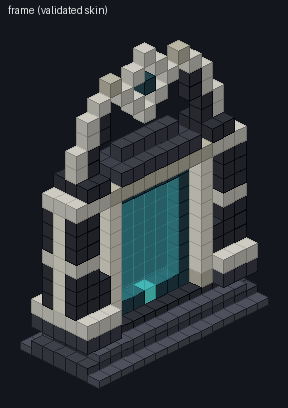
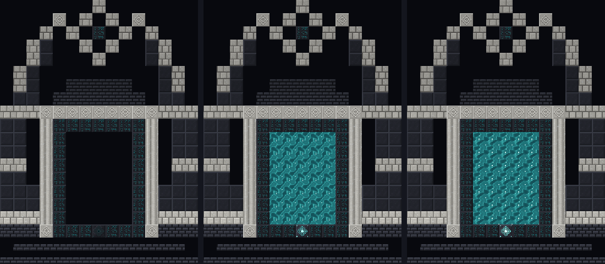

# Gateway portal — design

**Status:** design, 2026-10-06. Built against
[`gateway-frame-format.md`](gateway-frame-format.md) without changing it. **Not yet seen in a
running client** (ADR-0008). Everything here compiles, passes a contract checker, and loads and
matches through the logic session's own `GatewayFrame` parser. But the keystone and field have
no look in game until the logic session registers them, and none of it has been looked at live.

| | |
|---|---|
| Frame | `data/ascension_worlds/ascension_worlds/gateway_frame/gateway.json` |
| Moon site | `.../gateway_frame/gateway_moon_site.json` |
| Tags | `data/ascension_worlds/tags/block/gateway_frame_*.json` |
| Decorative blocks | `internal/GatewayDecorBlocks.java` |
| Textures | generated by `tools/generate-gateway-art.py`; previews in `design/gateway/` |

## Visual intent

**The ring is universal, the body is local.** The ancients cut every gateway's body from the
stone of the world it stands on, but every ring from the same inscribed stone, in the same script.
So the Moon's gateway is lunar basalt and anorthosite, a player's Earth gateway is deepslate and
quartz (or whatever its tags allow), and both are bordered by the same **Inscribed Gatestone**.
Walk up to any gateway on any planet and the ring is what tells you what it is.

The silhouette is the thing that should read from a distance:

- **A crescent arch.** Two dark buttressed blades flank the gate, then lean in above the lintel
  as one-block-thick horns with pale outer edges, so the outline still shows against the
  Moon's black sky.
- **A floating eye.** Between the horn tips hangs a hollow pale diamond with a gatestone pupil,
  attached to nothing. The diamond is the network's motif: it is carved into Chiseled Anorthosite
  and is the keystone's glyph.
- **A deep doorway.** Fluted pillars and a chiseled lintel frame a recessed reveal. The rune ring
  sits one block further back, and the field one plane behind the front face, so the opening has
  shadow and depth rather than sitting flush like a Nether portal.

**Dormant → active is the event.** Dormant, the opening is empty, the runes are a dim teal and
the keystone's eye is dead grey. Active, the opening fills with a full-bright, translucent field
of rising teal light and drifting star glints. The keystone's glyph lights cyan, and a pulse
runs inward along its rings and makes the gem breathe. Teal is the network's colour. It is
not the Nether's purple and not the End's black starfield, and it rhymes with the Warden's
bioluminescence, which is what opens Earth's gate.




## The frame

15 wide × 20 tall × 7 deep. Field 5 × 7 in row `z = 3`. Keystone at `(7, 2, 3)`. The whole
thing is mirror-symmetric in x, so the logic's no-mirrored-builds rule never bites.

| Char | Requirement | Moon places |
|---|---|---|
| `D` | `#gateway_frame_dark` | Lunar Basalt Bricks |
| `d` | `#gateway_frame_dark` | Polished Lunar Basalt |
| `P` | `#gateway_frame_pale` | Anorthosite Bricks |
| `I` | `#gateway_frame_pillar` | Anorthosite Pillar |
| `C` | `#gateway_frame_accent` | Chiseled Anorthosite |
| `_` | `#gateway_frame_step` | Lunar Basalt Brick Slab |
| `G` | `ascension_worlds:inscribed_gatestone` | — |
| `K` | keystone | — |
| `O` | field | — |

`D` and `d` share a tag on purpose. An Earth builder can use one dark block throughout, and the
Moon copy still gets two textures.

### Layer by layer

| y | What |
|---|---|
| 0 | Dais, lower tier: 15 × 7, with a row of half-slab steps front and back. |
| 1 | Dais, upper tier: 13 × 5 polished, with its own half-slab steps. Both tiers can be walked up without jumping. |
| 2 | The threshold. The gatestone ring's bottom row, with the **keystone at its centre**. Chiseled bases under the four gate pillars. The blades' buttress feet, 5 deep. |
| 3 | A pale course across the blade feet. The field begins. |
| 4–10 | Blades: polished dark, a pale course at y=7, and a pale pillar spine down each outer face. From y=6 a one-block slot opens between each blade and the gate. Fluted pillars frame the reveal front and back. The ring's side columns hold the field (y=3–9). The ring's top row is y=10. |
| 11 | The chiseled lintel, running the gate's full width and depth, met by pale courses on the blades. |
| 12–13 | A stepped dark pediment under the eye. The blades begin to lean in. |
| 13–18 | The horns: one block thick in the field plane, pale outside and dark inside, with chiseled tips at y=18. |
| 15–19 | The floating eye: a hollow diamond of pale bricks, gatestone pupil at (7, 17). It touches nothing. |

**Validate the skin, not the core.** 102 cells are hidden on all six sides: dais interior,
blade cores, the lintel's middle. They are spaces (don't care), so they are never checked. A
player can fill them with cobblestone, or leave them hollow. The look is unchanged and the bill
below is 102 blocks lighter. The Moon copy's site file fills the same cells with raw basalt
(ashlar facing over a rubble core, which is how real ancient masonry was built), so mining into
the ruin finds stone, not air.

### Activation and walk-in

The keystone's front face is open into the reveal. A player standing on the dais in front of
the gate has it at their feet, 0.8 blocks from the eye (checker-measured), and it is the first
thing lit at the bottom centre of the opening. Walking in means hopping one block up onto the
threshold, the same as stepping over a Nether portal's obsidian lip. The contract's "land just
in front of the field" should put arrivals on the dais inside the reveal, facing out down the
steps. That's the logic session's call; the reveal is clear floor either way.

## Earth bill of materials

418 placed blocks, plus the keystone (all counts measured from `gateway.json`):

| Requirement | Count | Earth-obtainable members |
|---|---|---|
| `#gateway_frame_dark` | 189 | deepslate bricks / tiles, polished deepslate, polished blackstone (bricks), smooth basalt, + the lunar basalt family |
| `#gateway_frame_pale` | 72 | quartz bricks / block, smooth quartz, calcite, polished diorite, + anorthosite (bricks) |
| `#gateway_frame_step` | 56 | deepslate brick / tile / polished slab, polished blackstone (brick) slab, + both lunar slabs |
| `#gateway_frame_pillar` | 46 | quartz pillar, polished basalt, + anorthosite pillar |
| Inscribed Gatestone | 28 | crafted: 8 polished deepslate + 1 echo shard → 8 |
| `#gateway_frame_accent` | 26 | chiseled quartz, deepslate, polished blackstone, stone bricks, tuff bricks, + chiseled anorthosite |
| Gateway Keystone | 1 | crafted, below |

What that costs in raw materials:

- **Every build:** about 250 cobbled deepslate (dark body, slabs, gatestone base); **8 echo
  shards** (4 for 32 gatestones, 4 for the keystone), the same as one recovery compass, and in
  practice one Ancient City, the same trip as the Warden; **4 diamonds**; **1 netherite ingot**
  (the keystone's lodestone); and the Warden tendril.
- **Moon-faithful look** (quartz trim, pillars, accents): about **576 nether quartz** on top.
  That's a real Nether session, and the intended "serious project".
- **Budget look:** polished diorite trim, polished basalt pillars and chiseled deepslate accents
  need no quartz at all. It looks rougher, and that's the player's choice to make. The rare gates
  (echo shards, keystone, tendril) are the same on either route.

Moon stone is in every tag too, so a player who has been to the Moon can haul anorthosite home
and build Earth's gate to match the ruin.

### The keystone recipe

```
D E D      D = diamond
E L E      E = echo shard
D E D      L = lodestone
```

The lodestone is the point: vanilla's own anchor-a-destination block, and it carries a netherite
ingot. Echo shards tie the keystone, the ring and the Warden to the same place. It is
deliberately below a beacon (no nether star). The boss gate is already the Warden tendril, and
a second boss would make Earth's gate absurd rather than serious.

## Decorative blocks

All registered in `GatewayDecorBlocks` (own `DeferredRegister`, one call from `AscensionWorlds`).
No behaviour. Each has a loot table, `#minecraft:mineable/pickaxe` membership through
`#ascension_worlds:gateway_decor`, crafting recipes and stonecutter recipes, and goes in the
Building Blocks creative tab.

| Block | Recipe | Used in |
|---|---|---|
| Polished Lunar Basalt | 4 lunar basalt (2×2); stonecutter 1:1 | frame `d`, plaza |
| Lunar Basalt Bricks | 4 polished (2×2); stonecutter from either 1:1 | frame `D`, plaza |
| Cracked Lunar Basalt Bricks | smelt bricks | site only |
| Lunar Basalt Brick Slab | 3 bricks → 6; stonecutter 1:2 | frame `_` |
| Anorthosite Bricks | 4 anorthosite (2×2); stonecutter 1:1 | frame `P`, avenue |
| Cracked Anorthosite Bricks | smelt bricks | site only |
| Anorthosite Brick Slab | 3 bricks → 6; stonecutter 1:2 | site (broken pillar tops) |
| Anorthosite Pillar | 2 bricks stacked → 2; stonecutter 1:1 | frame `I`, site pillars |
| Chiseled Anorthosite | 2 slabs stacked; stonecutter 1:1 | frame `C` |
| Inscribed Gatestone | 8 polished deepslate *or* polished lunar basalt + echo shard → 8 | frame `G` |

Hardness and blast resistance match each block's raw stone, as vanilla's stone bricks match stone.
The gatestone is tougher (3.0 / 9.0).

## The Moon site

29 × 22 × 18, `frame_offset [7, 2, 6]`: the frame sits centred, with six rows of plaza in front
and five behind. Seeded (`1969`), so it is the same ruin in every world.

| What | Where |
|---|---|
| Rubble foundation | site y=0, under the plaza |
| Eroded plaza | site y=1: an ellipse of polished and brick flagstones, ~16% cracked, scattered regolith, flagstones missing toward the edge so the terrain shows through |
| The avenue | pale anorthosite brick, from the plaza's front edge to the dais steps |
| Avenue of pillars | four anorthosite pillars on basalt plinths flanking the avenue, heights 1–5. The shortest is a stump, and its fallen drums and capital lie on the plaza beside it. |
| Corner obelisks | two broken pillars on 3×3 plinths at the back corners (one shed its top as rubble) |
| Front plinths | one intact with a chiseled cap, one shattered |
| Back wall | a low, broken run of basalt bricks |
| Regolith drifts | banked against the dais sides, deepening toward the back: the dust of ages |
| Rubble core | raw basalt in the frame's 102 hidden cells |

Two guarantees, both checked: **the site never occupies a frame cell** (so it does not matter
whether logic places site or frame first), and it never places in the field or anywhere in
front of the gate across the opening's width. Arrivals always land on clear ground.

**Height assumption:** the plaza floor (site y=1) is meant to sit at ground level, with the
foundation one block under it and the frame standing on the plaza. If logic drops the site's
y=0 on the surface instead, the ruin stands on a one-block podium. That still reads fine, it
just isn't what was intended.

## Looks for the logic-owned ids

- **`gateway_keystone`.** `active=false` → `cube_all` with the dormant eye.
  `active=true` → a `cutout` model with two elements: the lit base, plus an overlay
  (`gateway_keystone_glow`, 16 frames, interpolated) set full-bright through NeoForge's
  per-element `neoforge_data` (`block_light`/`sky_light` 15, unshaded). The glyph glows in a
  dark room whatever light level the block emits. Item model parents the dormant block.
- **`gateway_field`.** `axis=x` / `axis=z` → `gateway_field_ns` / `_ew`. Same 4-px slab
  geometry as `nether_portal`, `render_type: minecraft:translucent` set in the model (so no
  render-layer registration is needed in Java), full-bright, no AO. Texture: 32 frames at
  frametime 2, interpolated, alpha 165–235. Every wave in it has a whole number of periods across
  16 px and across the loop, so a 5 × 7 opening has no seams and the loop never jumps.
- **`warden_tendril`.** `item/generated`: a curved horn of dark teal skin, glowing cyan along its
  inner edge, torn at the root.

Both NeoForge model features were confirmed in the 21.1.249 sources (`ExtendedBlockModelDeserializer`
reads `render_type`; `BlockElement`/`BlockElementFace` read `neoforge_data`).

## Texture sources

All 14 PNGs are **original**, generated by `tools/generate-gateway-art.py` (seeded, reproducible).
Stone is procedural: brick and ashlar layouts with per-brick tone, lit and shadowed edges, and
plagioclase flecks in the anorthosite. The runes, the eye glyph and the tendril are hand-placed
pixel maps in that file. The field is a periodic, domain-warped wave sum with rising glints. **No
third-party art, CC0 or otherwise, is used.** Contact sheet: `design/gateway/textures.png`.

The raw Moon stones still borrow vanilla placeholders (diorite, basalt side, calcite). The new
palettes were picked to sit beside those. Re-texturing the raw stones in the same palettes would
be a natural follow-up.

## For the logic session

Things this design assumes or needs from the other side, none of which this branch touches:

1. **A `BlockItem` for `gateway_keystone`.** The recipe's result and the item model both resolve
   to that id. Without the item, the recipe fails to load (logged, not a crash).
2. **The keystone's loot table and mining tag.** That's behaviour, so it's left to logic. But it
   costs a netherite ingot, so it should drop when mined.
3. **Light.** Suggested `lightLevel` 12 for an active keystone and 11 for the field (the Nether
   portal's). The models glow full-bright either way. Real light is what makes it an event at
   night.
4. **Default states are safe.** Every orientation-sensitive block in the frame and site places
   correctly in its default state (bottom slabs, upright pillars). Nothing depends on rotation.
5. **The keystone is a border cell.** It sits in the field's bottom border row, so breaking it
   collapses the field like any other border block.
6. **Checked against `GatewayFrame` (9ff126f).** A throwaway test (not committed) ran the
   shipped `gateway.json` through `GatewayFrame.CODEC` and `match()`. It loads: 453 cells, 418
   blocks. It is recognised built in all four facings. A missing ring stone breaks the match,
   and junk in the hidden core or the blade slots does not. Two findings from that run:
   - **The frame is front/back symmetric**, so a build facing north is recognised as facing
     south (and east as west); `match()` returns the first facing that fits. The opening is the
     same either way, and both sides have identical steps, so arrivals may come out the "back".
     That is harmless, but worth knowing before anything starts to rely on `facing()`.
   - **`arrivalSpot()` lands one block above the reveal floor.** It assumes ground level with
     the field's bottom row, but this design's threshold stands one block proud of the dais, so
     arrivals drop one block (no damage). Either snap the arrival down to the first solid block,
     or ask design to raise the reveal floor. That would bury the keystone's front face, which
     is why it wasn't done.

## What the format could not express

Proposals only. The contract is unchanged.

- **Block states in key entries** (`{"tag": ..., "place": ..., "state": {"facing": "north"}}`).
  It would allow real stairs on the dais and horizontal fallen pillar drums in the ruin.
  Worked around with half-slab steps and brick rubble.
- ~~**Lit-on-activation decoration.**~~ **Done 2026-10-06** by the logic side, without a format
  change: any frame block with vanilla's `lit` property switches on when the gate is attuned
  (gateway-frame-format.md, "Blocks that light up"). The Inscribed Gatestone now has it, with a
  full-bright rune overlay (`inscribed_gatestone_glow`, generated by `gatestone_glow()` in
  `tools/generate-gateway-art.py`) whose glint runs down the three lines of script.
- **"Must be air" cells**, as distinct from don't-care. The slots between blades and gate are
  spaces, so a player can fill them and still validate. Harmless, but the format can't say
  "keep this open".
- **Site terrain conforming.** Something like `"foundation": "ascension_worlds:moon_basalt"`
  (extend the site's bottom layer down to solid ground) would stop a one-layer foundation from
  floating over a crater rim.

## Live checklist (ADR-0008)

When the logic session's blocks exist, on a dedicated server:

- [ ] Moon copy generates with the site around it; ruin reads as a ruin; nothing floats badly.
- [ ] An Earth build validates in all four facings, with the quartz route and the budget route.
- [ ] Keystone glow overlay renders full-bright without z-fighting; the pulse runs inward.
- [ ] Field is translucent, glows in the dark, tiles seamlessly across 5 × 7, no visible loop jump.
- [ ] Crafting/stonecutter/smelting recipes all appear and work; slabs drop 2 when double.
- [ ] Textures look right beside the vanilla-placeholder raw Moon stone.
