# Lore art, round 1 — design

**Status:** design, 2026-10-10. Built against [`lore-art-format.md`](lore-art-format.md), whose
sections 3 and 4 this round changed to Format B (agreed with Sanchit). **Not yet seen in a running
client** (ADR-0008): the previews below come from our own renderers, through the game's transforms
where it matters, and prove the art is coherent, not that it works in game. Every model resolves and
`./gradlew :modules:worlds:build` passes.

| | |
|---|---|
| Script, font, mark, pylon glyph, moon signal | `tools/generate-lore-art.py` |
| Murals, the Sealers' Record and its frame, the shrine's mural | `tools/generate-archive-art.py` |
| The pylon band, the sealed room's frame, `keeper_shrine.nbt` | `tools/generate-lunar-archive.py` |
| New block | `ascension_worlds:mark_glyph` (`MarkGlyphBlock`, registered in `ArchiveDecorBlocks`) |
| Previews | `design/lore-art/` (and the Archive's own, refreshed, in `design/lunar-archive/`) |
| **Record tiles** | **121–174**, frame cell (col, row) takes `121 + 9 × row + col` |
| **Torn-out sockets** | tiles **175–177** |
| **Shrine** | `keeper_shrine.nbt`, **9 × 9 × 9**, floor row **3**, mural on the **z = 8** wall |
| `ArchiveMuralBlock.TILES` | **193** |

Run the three generators in this order: `generate-archive-art.py`, `generate-lunar-archive.py`,
`generate-lore-art.py` (the last reads the templates for its in-world views; `--no-3d` skips them).
Re-running all three reproduces every committed file byte for byte.

## What it is

The truth of this story survives only in pictures, so this round draws the pictures. A script of
seven glyphs and an eye, which is the mark on the player's hand, the band on the pylon, Tacita's
signature and the illagers' brand all at once. The murals that contradict the voice's tablets, made
sharper: cats in the gate halls, the blue world always on the left, the dark coming out of it, the
road to it hacked out. The record the porters carried off, and the empty wall it was carried off
from. And the shrine behind the Guardian that shows what the keepers were for.

## 1. The script

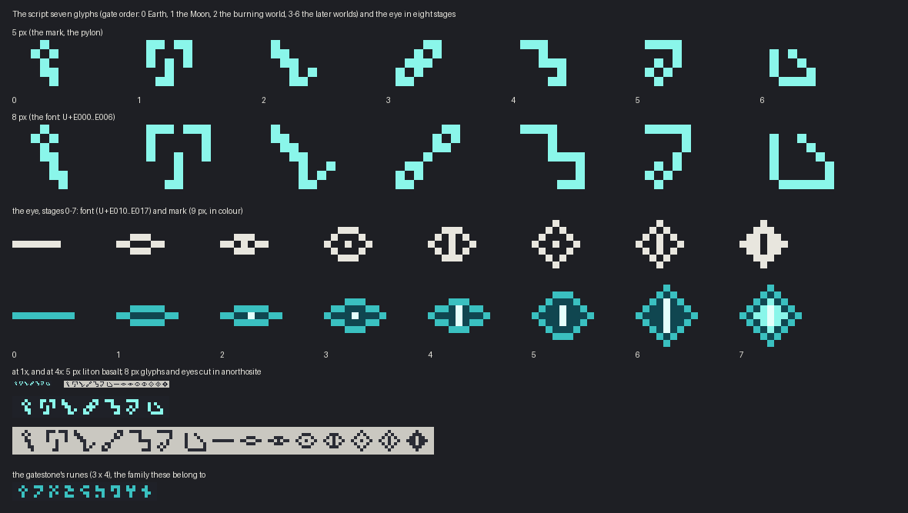

Seven glyphs, one per gate in gate order, and the eye in eight stages. Each glyph has two drawn
forms, 5 × 5 (the mark, the pylon) and 7 × 7 in an 8 × 8 cell (the font), with the same skeleton.

| | name in the code | silhouette |
|---|---|---|
| 0 | key | a counter on a stepped stem: tall and narrow. It is the gatestone's first rune grown up, so the first glyph on your hand is the script you just saw cut into the ring |
| 1 | gate | two posts, the lintel broken, a stone hanging through the gap: wide, top-heavy |
| 2 | blade | a stepped fall that curls up at its end: falling left to right |
| 3 | chain | two counters linked on the rising diagonal |
| 4 | stair | a bar that steps down twice and turns back |
| 5 | hook | a bar bent down into a hanging counter |
| 6 | basin | a wall and a floor, and a stroke falling into the corner: low, cupped |

**How they were found.** The family is the gatestone's runes (`RUNES` in the gateway script):
one-pixel strokes, diagonals as steps, small closed counters, compact blocks rather than airy
strokes. Four rounds of drafts are worth recording. Airy single-stroke glyphs read as arrows, a check
mark, Y and L. Putting a small diamond counter in every glyph (the eye in each sign) turned them
figurative: balloons, keys, a fish. Every glyph built from the diamond eye's lattice clumped into
arrowheads at 5 px. What worked was extrapolating the runes' own moves (a stem with steps, stacked
steps, a hook off a bar) into seven different silhouettes, then cutting any that read as a letter,
digit, cross or face (rejected: a face, an eject symbol, K, 5, 2, G, a U, Hangul ㅏ). The pairwise
overlap check in the drafts kept the closest pair under 0.5.

**The eye** is the network's diamond eye, opening: a shut line, an almond, the full diamond; its
pupil goes from nothing to a point to a cat's slit, and at stage 7 the whole iris lights round the
slit. The first stage 7 was concentric diamonds, the gates' own eye, and at 7 and 9 px it read as a
checkerboard. Pupils are a dot or a slit, never centred crosses.

## 2. The font

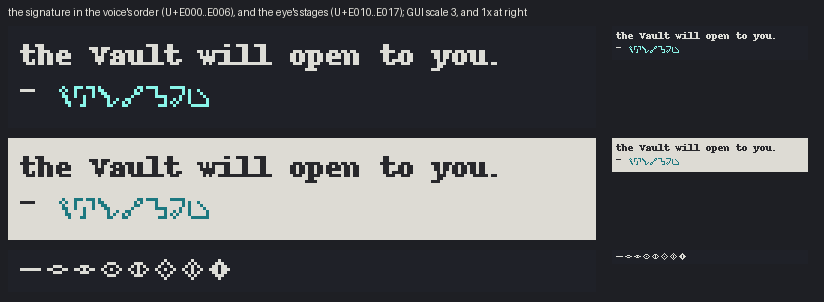

`font/script.json`: one bitmap provider, `ascension_worlds:font/script.png` (64 × 16, 8 × 8 cells),
height 8, ascent 7, the same metrics as vanilla's text, so a glyph's top is a capital's top and it
sits on the baseline. U+E000–E006 are glyphs 0–6 (the row is padded with U+0000), U+E010–E017 the eye
stages 0–7. Pixels are white: the line's text colour is the colour it shows in. Use it as the font
`ascension_worlds:script`. The preview sets the voice's signature (glyphs 0 to 6, the order the locks
break) under a tablet's last line, beside a stand-in for the game's text (Pillow's bitmap font;
vanilla's is not ours to draw with).

## 3. The mark (Format B)

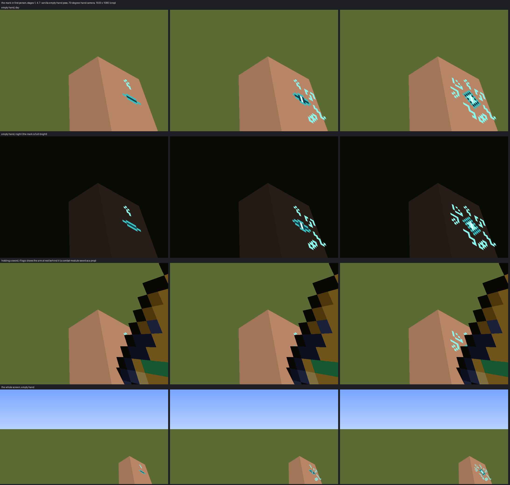

Vanilla's first-person empty hand (`ItemInHandRenderer.renderPlayerArm`, rebuilt in the preview
from the 1.21.1 transform) shows only the arm's outer and front faces, and only about eight rows of
them: some 8 × 8 skin pixels, at an angle. Seven glyphs and an eye do not fit, so the mark is a decal,
and the contract's section 3 now says exactly where it goes. In short:
`entity/mark/stage_1..7.png`, 24 × 24, every drawn pixel opaque; a quad on the right arm's outer
face, `z` −2..2 and `y` 5..9 (the back of the hand and wrist), 0.3 px out so it clears the sleeve,
at `x` −3.3 on the wide arm and −2.3 on the slim; top toward the fingers, left toward the front, so
it reads upright to its wearer. Full-bright; ordinary light where it goes dark (dust storms, the
Deep Dark).

Glyphs 0..n − 1 ring the eye at stage n, glyph 0 at the top and clockwise, the way a count fills;
slots not yet earned are bare skin. Rows 5–9 were chosen over the fingertips (crowded at the far end
of the arm) and the forearm (slides off the bottom of the screen).

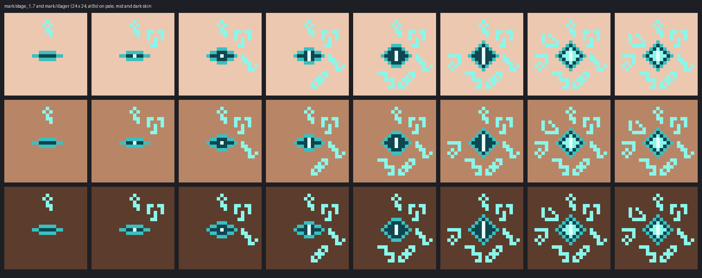

**Holding an item.** Vanilla draws no arm at all then. The preview shows the obvious choice, the arm
at rest behind the item: a sword covers much of the mark, and it stays readable at its edge. Lower
the arm and it hides completely. That is logic's call, and worth a live look.

## 4. The illagers' mark

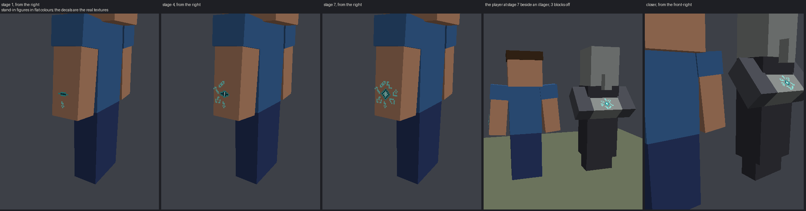

`entity/mark/illager.png` is the stage-7 picture, the same pixels: the player's mark becomes theirs
exactly. It sits on the front of the crossed arms' middle box, 4 × 4 model pixels, upright to whoever
faces the illager (contract section 4). The player wears theirs for themself; the illagers wear
theirs for the world. In third person the player's mark shows on the outer side of the hanging arm,
upside down, as any hand tattoo looks to anyone but its owner.

## 5. The pylon's glyphs

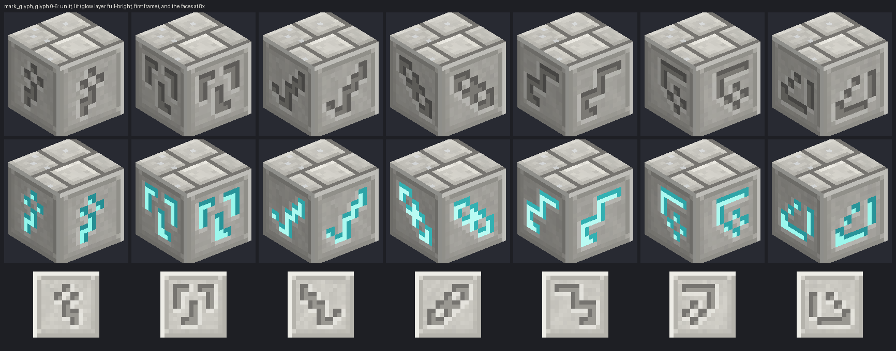

`ascension_worlds:mark_glyph`, properties `glyph` (0–6) and `lit`, registered in
`ArchiveDecorBlocks` through `MarkGlyphBlock`: unbreakable in survival (strength −1, blast
3,600,000), no loot, push reaction BLOCK, light 7 when lit, in the building-blocks tab. Lang name
*Carved Glyph*. Each glyph is cut at double size into a dressed anorthosite panel, lit from the
top-left: the cut's near wall in shadow, its far wall lit, the rim past it catching the light. Lit,
a full-bright layer fills the cut with teal and breathes (16 frames at 3 ticks), each glyph a seventh
of a cycle behind the one above, so a lit column reads as one inscription waking. Fourteen models,
one blockstate.

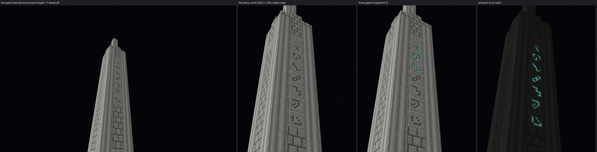

**The band** in `entrance.nbt`: a column down the standing pylon's face toward the court (the `+x`
face of the shaft centred at `x` 2, `z` 33), at `x` 3, `z` 33, glyph *k* at `y` 35 − *k* (glyph 0 at
`y` 35, glyph 6 at `y` 29; the paving is `y` 21). A band of chiseled anorthosite, the eye, runs round
the shaft at `y` 36 above it: seven signs under an eye, like the hand. All seven are placed unlit;
the generator checks each is placed once, unlit, with its face open to the air. The old band of
gatestone script is gone.

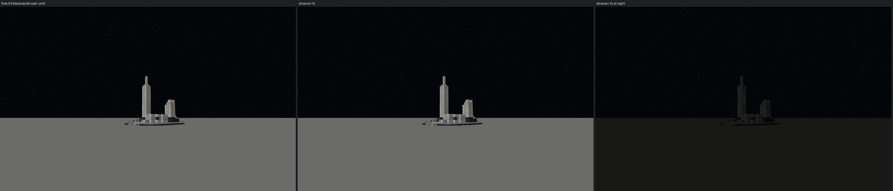

From 64 blocks the pylon is the same pale stroke; by night the lit glyphs are a few teal points.
That is why the light seen from Earth is a sky texture (section 9), not this.

## 6. The murals, revised

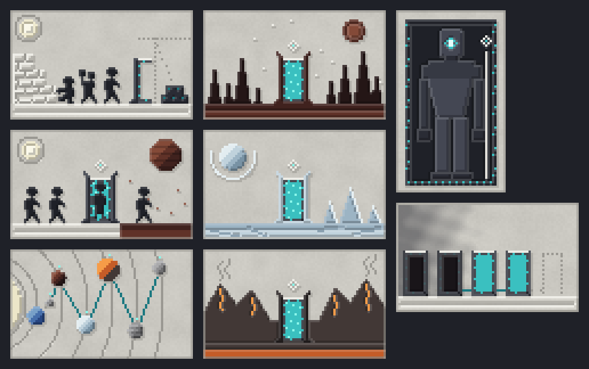

- **Cats**, sparingly: one sitting on the cut stones in *The Stonecutters*, watching the work; one
  where the walkers set out in *The Step*. Two more in the Sealers' Record (panels 1 and 5). Cats
  are the only creatures that can see the Observers.
- **Earth's side is the left.** *The Road* already put the blue world there. *The Step*'s near side
  is now inlaid with the blue world's stone (the far side is ash; the ring stands on the seam).
  *The Quiet* now shows the blue world at its top left, and the dark pours out of it, staining the
  plaster and putting out the nearest rings first. The voice says the dark came from the far worlds.
- **The Road.** The Moon moved out from the blue world so the road between them has length, and that
  road is now a channel hacked out of the plaster: the dark bed the teal was set in, chisel bites
  along its rim, and one sliver of teal the Sealers missed. A pale incision on pale plaster
  vanished; the dark bed is what reads.
- **The Keeper** holds its staff level across the ring's opening, both hands closed on it, the eye
  finial against the ring: a bar across a door. It keeps the ring shut.

Mural sizes did not change, so tiles 1–120 kept their numbers and the templates needed no change
for them. Every mural still reads left to right in every rotation (`place_mural` is unchanged).

## 7. The Sealers' Record

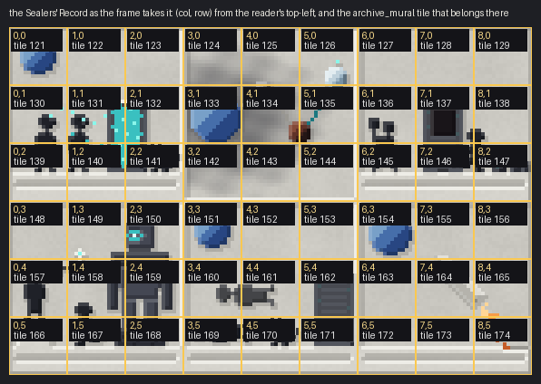

One canvas of 9 × 6 tiles: six panels of 3 × 3, read left to right, top row then bottom, each in a
raised border. The blue world is at the left wherever it shows.

1. People breathing beside a lit ring, its air drifting out to them; a cat by the ring.
2. The dark pouring out of the blue world, along the road, ring by ring; the farthest gate still lit.
3. The Sealers walling up their own ring in stone courses, its keystone prised out and lying beside it.
4. A keeper, its feet still uncut rock, being carved; a Sealer on a step passes it the key.
5. People lying still beside the dark ring. The cat is still there.
6. One figure leaving on a ship, rising on fire toward the blue world. That is Tacita.

**Tiles and layout:** record tiles are **121–174**. Frame cell (col, row), col 0 at the reader's left
and row 0 at the top, takes tile **121 + 9 × row + col** (`record_frame()` in the generator lists all
54 with their positions).

**The frame**, in `vault.nbt`: the sealed room grew from 7 × 5 to 9 wide × 7 tall (interior `x` 8–16,
`y` 2–8, `z` 24–29) so the record fits its back wall. The frame is the wall at `z` 23, `x` 8–16,
`y` 3–8 (row 0 at `y` 8), over a pale sill at `y` 2, read by someone standing in the room facing
north (so col 0 is at `x` 8). Every cell holds one of three **torn-out sockets** (tiles
**175–177**): hacked plaster, the rough bed showing, chisel bites round the rim. No record tile is in
the template. The room's plinths, bench, seal and breach are where they were (the seal is taller);
the enlarged room stays outside the rotunda's wall ring, and the light check still finds no dark
floor.

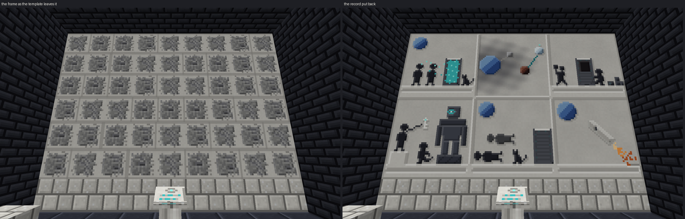

## 8. The keeper shrine

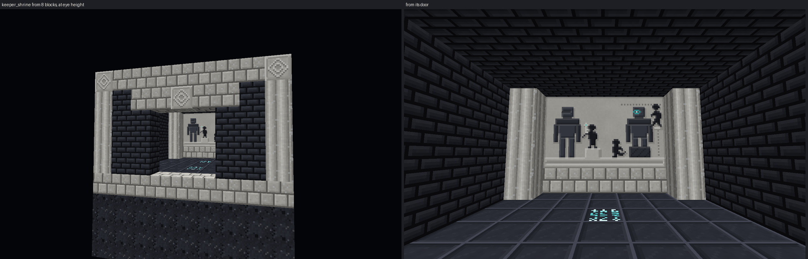

`data/ascension_worlds/structure/keeper_shrine.nbt`, **9 × 9 × 9**. Shrine coordinates: `x` across,
`z` from the door (0) to the mural's wall (8).

- Rows `y` 0–2: a rubble footing of raw basalt under the whole footprint. **Row `y` 3 is the floor**,
  the row to set on the ground.
- A chamber of basalt bricks, interior `x` 1–7, `y` 4–7, `z` 1–7, roof at `y` 8 with a pale cornice,
  pale pillars at the corners.
- **The door** is in the `z` 0 wall, `x` 3–5, `y` 4–6, under a pale lintel with the eye.
- **The mural** is on the **`z` 8 wall**, `x` 2–6, `y` 5–7, on a pale sill at `y` 4, between two
  pillars, read from inside facing `+z`. Tiles **178–192**. It shows the Sealers making the keepers as
  a pair: the sleeper, its eye shut, takes the key into its hand from a Sealer on a step; the guard,
  its eye open, is still being cut from the rock. One to sleep until needed, one to stand.
- Lit gatestone in the floor at (4, 3, 2) and (4, 3, 5); the light check finds no dark floor. No
  entities, no block entities. Deterministic, DataVersion 3955.

A first draft laid the sleeper on a bier, turned on its side; it read as a machine. Both keepers
now stand.

## 9. The light on the Moon

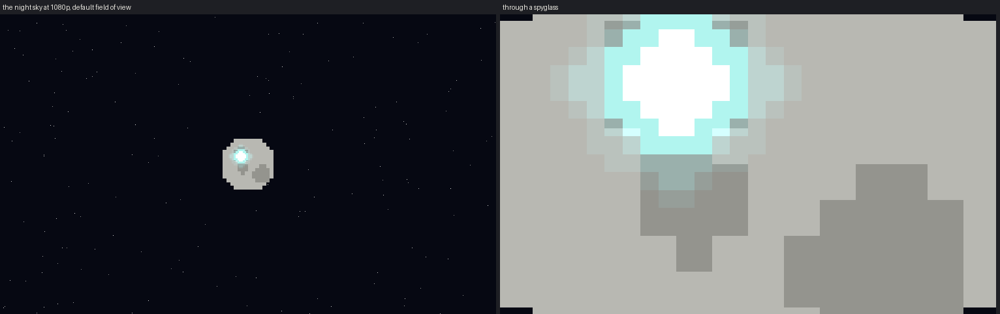

`environment/moon_signal.png`, 16 × 16: a white-hot core in a teal halo that falls off as a diamond
(no rays, which at this size would be a cross). Alpha carries the falloff, for additive blending the
way the sun is drawn. The preview draws it at a quarter of the moon quad's width, a little up and left
of the disc's centre, over a stand-in moon (vanilla's is not ours to draw); it reads as a point of
teal at the default field of view and as a soft diamond through a spyglass.

## How it was checked

- **Reproducible:** running the three generators twice changes no file.
- **The contract's checks still run** in `generate-lunar-archive.py` (entries, orrery, loot, jigsaws,
  free-standing plinths, light), plus new ones: each glyph placed once, unlit, face open; the shrine
  under 16 and holding its whole mural; zero dark floor cells in all three templates
  (entrance 42, vault 775, shrine 50 floor cells checked). `generate-archive-art.py` still refuses to
  run unless `ArchiveMuralBlock.TILES` matches its 193.
- **The mark's layout:** `check_mark()` refuses glyphs that touch each other or the eye, or leave
  the decal.
- **Previews through the game's transforms:** the arm in first person from vanilla's
  `renderPlayerArm`, the held item through `render-item-model.py`'s item transforms, the pylon,
  record and shrine from their real block models. `render-structure-preview.py`'s isometric views
  (`render_iso`, `render_iso_states`, `render_block_model`) turned out to draw a **mirror image**;
  that is flagged as its own task, and this round's previews do not use them.
- `./gradlew :modules:worlds:build` passes.

## For the logic session

1. **The mark is Format B** (contract sections 3 and 4): one 24 × 24 texture per stage, and
   `illager.png`, drawn as quads; wide and slim arms share the textures. The first-person arm in its
   empty-hand pose is in the preview code (`first_person_arm()` in `generate-lore-art.py`), if a
   reference helps.
2. **Pillagers rarely cross their arms**: the crossed-arms box is drawn only while an illager is
   neither attacking, casting nor holding a crossbow, so a pillager would almost never show its mark.
   If that matters, the same decal fits the right arm's outer face exactly as on the player
   (illager arms are 4 × 12 × 4).
3. **The pylon's glyphs** are found by id and the property names `glyph` and `lit`; positions are in
   section 5. `MarkGlyphBlock` exists if the class is handier than the id.
4. **The Sealers' Record**: tiles 121–174, layout and frame position in section 7. A recovered tile
   placed into the frame replaces a socket. Whether the frame is complete is a check over 54 cells.
   54 tiles is a lot of Endermen; how many carry tiles, and how many the ending needs, is a design
   question for Sanchit, not an art one.
5. **The shrine**: 9 × 9 × 9, floor row 3, door on the `z` 0 side, mural on the `z` 8 wall.
6. **The moon signal**: drawn additively over the moon once gate 0 is lit, about a quarter of the
   moon quad's width, a little up and left of centre. Brightening it with each lit gate is an option
   the texture supports (scale the alpha).
7. **The font**: `ascension_worlds:script`; the signature in the voice's order is
   U+E000 to U+E006.

## What the format could not express

- **The mark while holding an item.** Vanilla gives the arm no pose then; section 4 above.
- **The mark's orientation to others.** One quad cannot read upright to both its wearer and an
  onlooker. Upright for the wearer won.
- **Live light on the pylon.** The glyph gives light 7 as a block property; the band's glow from the
  court is the full-bright layer, and from Earth it is the sky texture.

## Live checklist (ADR-0008)

On a dedicated server and in a client, once logic's pieces exist:

- [ ] The signature line sits on the reader's baseline, glyphs at capital height, advances even; the
      text colour tints it.
- [ ] The mark appears at stage 1 when the first gate lights, on the back of the right hand, upright
      in first person, full-bright, clear of the sleeve layer, no z-fighting; wide and slim skins.
- [ ] It follows the swing and every arm pose; it grows a glyph and opens the eye at each gate; it
      goes dark in a Moon dust storm and in the Deep Dark.
- [ ] Another player sees it in third person; it syncs on attunement and survives relog.
- [ ] Holding a tool, the mark shows (however logic chooses to draw it).
- [ ] Vindicators and evokers show the stage-7 mark on their crossed arms, reading as the same mark.
- [ ] `mark_glyph`: all fourteen states render; the lit layer breathes, glyph by glyph down the
      column; light 7; unbreakable in survival; in the creative tab; the item shows glyph 0.
- [ ] The pylon band lights glyph *k* when gate *k* lights, readable from the court, in every start
      rotation; persists across unload and reload.
- [ ] The murals: both cats visible at 3–5 blocks; the Road's hacked-out channel and its sliver
      readable; the Keeper's staff reads as a bar; *The Quiet*'s dark comes out of the blue world.
- [ ] The sealed room's frame shows 54 sockets; a record tile placed in its cell completes that part
      of the picture, reading left to right; the room is spawn-proof.
- [ ] The keeper shrine generates beside the citadel on the ground, its mural facing the door,
      spawn-proof overnight.
- [ ] The light on the Moon shows from Earth at night once gate 0 is lit, and through a spyglass.
