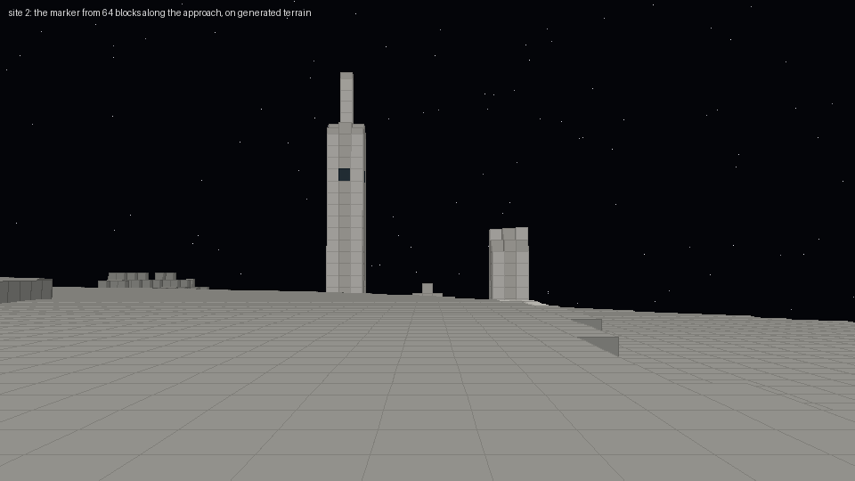
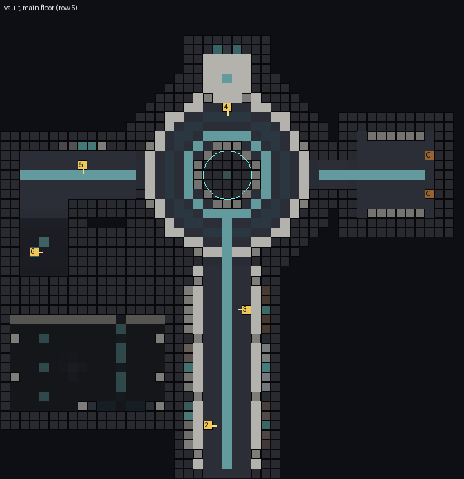
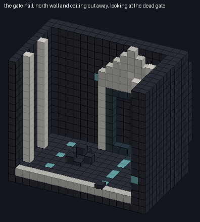
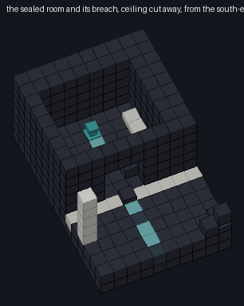
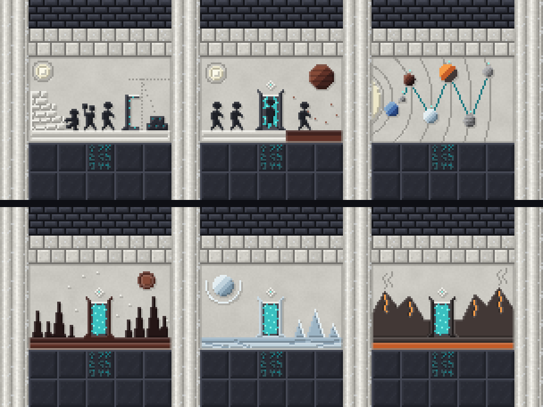
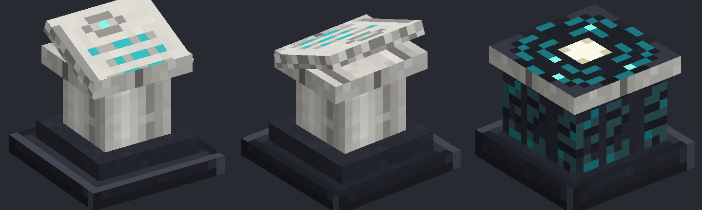

# The Lunar Archive — design

**Status:** design, 2026-10-07. Built against [`lunar-archive-format.md`](lunar-archive-format.md);
the changes it asks of logic are proposed there, under "Design's handover". **Not yet seen in a
running client** (ADR-0008). The templates have been placed on a dedicated server through a
throwaway datapack standing in for logic's worldgen (four sites, four terrains, three rotations)
and compared with the world block for block. Every model resolves. Nobody has walked it.

| | |
|---|---|
| Templates | `data/ascension_worlds/structure/lunar_archive/entrance.nbt`, `vault.nbt` |
| Their generator | `tools/generate-lunar-archive.py` (seeded, byte-for-byte reproducible, checks the contract and the light) |
| Art | `tools/generate-archive-art.py`: murals, plinth/orrery/tablet looks, stair and mural models |
| Decorative blocks | `internal/archive/ArchiveDecorBlocks.java`, `ArchiveMuralBlock.java` |
| Previews | `design/lunar-archive/` |
| **`surface_y`** | **21**: the court's paving row in `entrance.nbt` |
| **Pieces** | **`entrance`** (start, 19 × 47 × 48) and **`vault`** (48 × 21 × 48), one jigsaw between them |

## What it is

The builders' record office, cut into the Moon a short walk north of their gateway. The player
finds two pale pylons on the plain, one standing and one fallen, and between them a stair cut down
into the regolith. It ends at a door whose diamond eye rises out of the ground. Below is a hall of
carved murals, a domed chamber with the orrery at its heart, and further down, past the place
where the carving stops, a gate the builders bricked up themselves. Across the hall from that gate
is the room where the last of them wrote the last inscription. Its seal has been broken, and the
rubble lies on the inside.

The tone the contract asks for is awe and loss, abandoned in a hurry, not horror. Three choices
carry it:

- **The script is the light.** There are no lanterns or torches. The vault is lit by the builders'
  own inscription, `inscribed_gatestone[lit=true]`, set into the floors as a glowing road that
  leads from the door to the orrery, and into the walls as labels under the murals. The road
  breaks up toward the end, and the dead gate is the only gatestone in the building that does not
  glow.
- **The ring is universal, the body is local** ([`gateway-portal-design.md`](gateway-portal-design.md)).
  The murals show the same ring standing on the ash plains, on a frozen sea and on the forge world,
  each time with blades of that world's stone.
- **"I can hear the gate across the hall."** The last inscription, *Unfinished*, is placed so that
  its reader faces the breach, and the dead gate stands beyond it, straight across the hall.

## The way through, in the order the player meets it

Plinths are numbered in reading order on the plans. The yellow tick points at the reader.

| # | Where | Inscription |
|---|---|---|
| 1 | the open cutting, before the first door | `the_road` |
| 2 | murals hall, before *The Stonecutters* | `the_builders` |
| 3 | murals hall, before *The Forge* | `many_worlds` |
| 4 | the keepers' niche, facing the orrery | `the_keepers` |
| 5 | the deep passage, before the unfinished mural | `the_quiet` |
| 6 | the stair down, on its landing | `the_last_order` |
| 7 | the sealed room, against its back wall | `the_sealing` |
| 8 | the sealed room, facing the breach and the dead gate | `unfinished` |

1. **The surface** (`entrance.nbt`). An eroded court of dark paving with a pale avenue down its
   middle. Two pylons flank the head of the cutting. The west one stands 23 blocks: a 3 × 3 shaft
   of anorthosite with pillar corners, a chiseled band at its foot, a band of gatestone script near
   the top, then a taper, a needle and an eye-carved cap. The east one snapped at 9, and its top lies
   across the court in drums, with its spire at the end. From 64 blocks the standing pylon is the
   mark, a pale stroke against the black sky (above, rendered from generated terrain).
   Earlier drafts topped it with a hollow diamond, which read as a ringed cross from any distance.
2. **The cutting.** An open stair of pale steps between retaining walls, down 7 blocks to a
   landing. The first door is a narrow, deep opening under a lintel. Above it is a **solid
   diamond**: a thick pale rim, a dark inner ring and a lit pupil. It rises out of the ground, so
   the court sees a pale gable and the cutting sees the whole eye. Plinth 1 stands on the landing
   before the door, under the sky.
3. **The covered stair.** 5 wide, 13 steps down with a landing halfway. Lit script is set into both
   walls at knee height on every other step.
4. **The murals hall** (vault). 7 wide, 21 long, 7 tall. A rhythm of pale pillars with chiseled
   capitals and transverse ribs, three five-block murals on each wall between them, a pale band
   above, and a lit tablet of script in the dark dado under each mural. The **road**, a line of lit
   gatestone, runs down the middle of the floor from the threshold to the orrery.
5. **The orrery rotunda.** 17 across, drum 6 tall, then a corbelled dome rising to a chiseled eye at
   its apex, looking down. A ring of lit script runs round the dome's springing line. Twelve pale
   pilasters stand round the drum: two at each door and one on each diagonal. The floor carries
   the orbits: a lit ring, a dark ring and a pale border. The **orrery** stands on a two-step dais
   at the centre, with the contract's 5 × 5 × 4 clear above it (checked). The north niche holds
   the keeper mural and plinth 4.
6. **The stores** (east door, off the main path). A short passage to a storeroom with shelves and
   **two chests** (`LootTable: ascension_worlds:archive/stores`).
7. **The deep passage** (west door). It runs past the **unfinished mural** and plinth 5, then turns
   south and down four blocks in two flights. Plinth 6 is on the landing between them.
8. **The gate hall.** 16 wide, 10 deep, 15 tall, with tall pale pilasters and a piece of fallen
   ceiling in its empty half. On the south wall is **the dead gate**. It is a full ring of
   (unlit) gatestone round a 5 × 7 field, bricked up in hurried rough masonry, with an empty socket
   where the keystone was prised out. Pale pillars and a lintel frame it, a stepped hood with a
   carved eye sits above, and a single lamp hangs in the ceiling over it. The road crosses the
   hall from the breach to the gate, every third stone dark.
9. **The sealed room.** Its wall toward the hall is rough, unbricked stone laid in a hurry, broken
   through, with the rubble fallen inward. Inside are a bench, plinth 7 against the back wall,
   and plinth 8 between it and the breach. The only light is script in the floor where the reader
   stands. The *Unfinished* reader faces the breach, and through it, 13 blocks away, the dead gate.

## Materials

Everything is the gateway's masonry plus three new blocks. The vault is dark (lunar basalt
bricks, polished basalt floors) with pale structure (anorthosite pillars, bands, ribs,
borders), the gateway's palette turned to an interior. Every room is wrapped in a one-block wall
and a rubble core of raw lunar basalt that the template places itself, so the terrain is never the
wall (contract). Empty space outside the build is `structure_void`.

| Block | New | Used for |
|---|---|---|
| Lunar Basalt Bricks / Polished / Cracked / Brick Slab | | walls, floors, the hurried seal, rubble |
| Anorthosite Bricks / Pillar / Chiseled / Cracked / Brick Slab | | pillars, ribs, bands, borders, pylons, the dais |
| Inscribed Gatestone `lit=true` | | the road, the labels, the springing-line ring: all the light |
| Inscribed Gatestone `lit=false` | | the dead gate's ring, the dark orbit, the pylon band |
| **Lunar Basalt Brick Stairs** | yes | the covered stair, the deep passage |
| **Anorthosite Brick Stairs** | yes | the open cutting |
| **Archive Mural** (`tile` 0–120) | yes | the murals; tile 0 is bare plaster |
| Archive Plinth, Archive Orrery | logic's | (looks below) |
| Lunar Regolith | | dust drifts on the court |
| `minecraft:chest` | | the stores |

The stairs are ordinary `StairBlock`s, hardness as their bricks, with crafting (6 → 4) and
stonecutter recipes from the bricks and from the raw stone, loot, `#minecraft:stairs`, and the
`#ascension_worlds:archive_decor` mining tag. Their blockstates were compared with vanilla's
`stone_brick_stairs`: all 40 variants match. Templates, unlike the gateway's frame format, carry
block states, so stairs face the right way and rotate with the piece.

**Archive Mural** is one block with a `tile` property (0–120) and a model per tile. Its loot table
copies the tile (`minecraft:copy_state`), so a mural taken down and put back up keeps its picture.
The stonecutter makes bare plaster from anorthosite. `ArchiveMuralBlock.TILES` must equal the art
script's tile count, and the art script refuses to run if they differ.

## Lighting

The Moon spawns hostiles at block light 0 (`dimension_type/moon.json`). The generator floods block
light from every emitter in each template, from `lit` gatestone at 9 and the orrery at 10. Light
passes through anything not solid; slabs, stairs and the plinth count as see-through, so the
check errs dark. It then fails if any cell a mob could stand on, under cover, has light 0.
**Both templates: zero.** It ignores sky light and light leaking across the jigsaw, so the real
vault is brighter than this check. No design block emits light and nothing new was asked of logic:
the lamps are the gatestone's existing `lit` state.

## The murals

Carved plaster in the art guide's light: raised work lit top-left and casting a shadow down-right,
incisions shadowed on their near wall. Coloured stone is inlaid where a world needs its colour.
Teal inlay glows, as a full-bright second model layer, the way the gatestone's runes do, so the
network's lines read in a dark hall. The builders are drawn **black-figure**, in their own dark
stone, because white-on-white relief vanished at viewing distance. They are tall, robed and
faceless, in profile.

| Mural | Where | Shows |
|---|---|---|
| The Stonecutters | west wall, 1st bay | a quarry; builders cutting, carrying a stone; a ring half raised, its stones already cut with script |
| The Step | west wall, 2nd | the same ring between two worlds: figures walking up on pale ground, one standing in the lit field, one stepping out onto ash under a stranger sky |
| The Road | west wall, 3rd | the sun at the edge, the orbits, every world they walked joined by a lit road out from the Moon. The road to the blue world is cut but never inlaid: its gate was never opened (*The Sealing*) |
| Ring on Ash | east wall, 1st | the ring on the ash plains: blades of dark ash-stone among black spires, a dim red sun (Planet 3) |
| Ring on Ice | east wall, 2nd | the ring on a frozen sea: pale ice-stone blades, icebergs, a ringed world in the sky |
| Ring on the Forge | east wall, 3rd | the ring among iron-dark mountains seamed with glowing fire |
| The Keeper | the rotunda's north niche, 3 × 5 | a keeper standing in the ring it guards: massive, built in courses, one diamond eye, a staff topped with the network's eye |
| The Quiet | the deep passage | four rings on the road, told in order: the first two dark, the dark staining the plaster in from the left, the next two still lit. The fifth, the Moon's own, is only scratched-in guide lines, and then the carving stops |

The east wall reads as one argument: three worlds, three different bodies, one ring. The west wall
is the story: cutting, crossing, the road. *The Quiet* comes after the orrery, where the tone turns.

## The plinth, the orrery, the tablet

- **Archive Plinth.** A pale fluted column on a dark base, a pale desk, and the tablet resting
  on it, tilted 22.5° toward its reader. The tablet carries an almond eye at its head and three
  lines of script, and the script and pupil glow, so a plinth invites reading in the dark. Modelled
  facing north (front toward a reader standing north), and the blockstate turns it by `facing`.
  The tablet's up face is turned half round in uv, because an up face lays its texture's top along
  the north edge, the edge nearest that reader. The first model read upside down, and
  `render_block_model()` caught it. The base fills the whole footprint (see the requests below).
- **Archive Orrery.** A squat drum cut with the gatestone script, on a full-footprint base, with a
  pale rim and a star-map top: a pale sun in concentric rings, two orbits and four worlds. Only the
  top glows. A glowing drum competed with the hologram logic draws above it.
- **Archive Tablet** (item). A pale stone tablet, the almond eye at its head, three lines of teal
  script, and an outline tinted toward the stone. The eye was first a three-pixel diamond, which is
  a plus sign at 16 px.

## How it was checked

- **The generator checks the contract before writing:** each piece fits 48 × 48 × 48. Each of the
  eight entries is used exactly once, and no unknown one. There is exactly one orrery with its
  5 × 5 × 4 clear. Every chest names the loot table. The jigsaws pair up. Every plinth stands free
  on a full block and faces a cell its reader can stand in. The light check passes.
- **Reproducible:** running both scripts twice gives identical bytes for all 350 files they write
  (sorted palette, fixed block order, gzip with no name and mtime 0).
- **Placed for real**, on a dedicated dev server with the full mod stack. A throwaway datapack
  (never committed) stood in for logic's worldgen: a `minecraft:jigsaw` structure,
  `start_height -21` projected to `WORLD_SURFACE_WG`, `terrain_adaptation: none`, and pools
  `start → entrance`, `lunar_archive/vault → vault`. It was placed with `/place structure` at four
  Moon sites, then the chunks were read back from the region files. **At every site all 22,395
  template cells matched the world, block state for block state, through two different start
  rotations.** All eight plinths had their entries, both chests their loot table, no jigsaw block
  was left behind, and no column of the vault's roof was exposed (ground cover 1–20 blocks,
  averaging 6.6–10.3). The court's rim met the ground within −1 to +3 blocks. That fit came after
  one fix: the first footing was two blocks deep and the ground at the first site ran 4 below to 4
  above the paving.
- **Models:** all 178 models in the module resolve their textures and parents, and none points at
  a vanilla texture. `./gradlew :modules:worlds:build` passes.

The `in-world-*` previews are rendered from those generated chunks. They show the real terrain the
throwaway seed gave, so they show the fit, not just the design.

## For the logic session

The worldgen wiring is in the contract's "Design's handover" section, with the reasoning:
`terrain_adaptation: none` rather than `bury`, `start_height` −21, the two pool names, and
`size` ≥ 1. The rest:

1. **Plinth and orrery shapes.** Both are plain full cubes in Java today, so the renderer treats
   them as opaque. Neither model fills its cube: anything touching a plinth's side would be culled
   into a see-through gap, and their corners get full-cube ambient occlusion. Please give both
   `.noOcclusion()` and a shape (suggested boxes in the contract). The templates already keep
   every plinth free-standing (checked), and both models have a full-footprint base, so the floor
   under them is never culled even before this lands.
2. **One line in `AscensionWorlds`** registers `ArchiveDecorBlocks`, the way `GatewayDecorBlocks`
   is registered.
3. **Moving inscriptions.** [`lore-spread-proposal.md`](../lore/lore-spread-proposal.md) suggests
   moving *The Last Order*, *The Sealing* and *Unfinished* off the Moon. The back half of this
   building (the dead gate, the breached room, the reader facing the gate) is staged for
   *Unfinished*. If those entries move, the plinths can be re-pointed in one line each in the
   generator, but the sealed room would want new text that earns its staging. That is Sanchit's
   call, and this is a flag, not a change.
4. **Surface features** (rock debris, small craters) generate after `underground_structures` and
   may land on the court. That is harmless, and a crater cut into the court would read as age.

## What the format could not express

- **Rotation.** A jigsaw start is placed in a random rotation, so the Archive's door does not
  always face the gateway, 256 blocks south. It doesn't need to: the pylons are visible from every
  side.
- **"Walk this way" across the joint.** The light check runs per piece. Light from the entrance's
  stair spills into the vault's threshold in game, and the check never counts it.

## Live checklist (ADR-0008)

When logic's worldgen places it, on a dedicated server and in a client:

- [ ] It generates at x −160, z −256 north of the gateway; the court sits on the ground (no
      floating edge, no buried paving); the pylons are visible from the gateway ruin.
- [ ] The standing pylon reads as a pale mark at render distance (and in Distant Horizons LODs
      once Chunky has generated it).
- [ ] The way down is walkable end to end with no head-bumps: open steps, covered stair, the
      deep passage's two flights.
- [ ] Murals read left to right from inside the hall in **every** start rotation; the teal
      overlays glow without z-fighting; black-figure builders read at 3–5 blocks in that light.
- [ ] Every plinth's tablet faces its reader and reads upright; each opens its own inscription;
      no see-through gaps beside them (before and after logic's `noOcclusion`).
- [ ] The orrery's base looks right under its hologram; the hologram clears the dome and the dais.
- [ ] No hostile spawns anywhere in the vault overnight, Endermen on.
- [ ] From the *Unfinished* reader's spot, the dead gate is visible through the breach.
- [ ] The stores' chests roll `archive/stores`; the room is findable but off the road.
- [ ] Stairs craft and stonecut; a mined mural tile puts its picture back up.
- [ ] Persistent across a world unload and reload: plinth entries, chest loot already rolled.
