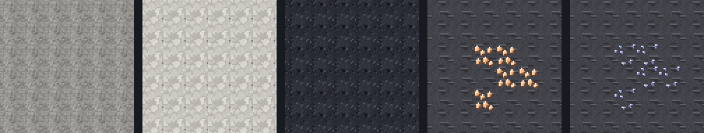

# Moon materials — art

**Status:** art, 2026-10-06. **Not yet seen in a running client** (ADR-0008). The textures are
generated and the models resolve, but nobody has stood on the regolith or broken the ore in game.

| | |
|---|---|
| Generator | `tools/generate-moon-materials-art.py` (seeded, reproducible) |
| Previews | `design/moon-materials/textures.png`, `in-context.png` |
| Palettes | imported from `tools/generate-gateway-art.py`, never copied |
| Method | [`art-guide.md`](art-guide.md), the general how-to this batch followed |

Replaces the last vanilla placeholders on the worlds module's raw materials. **Every pixel is
original:** procedural noise, or pixel maps placed by hand in the generator. Nothing is traced,
sampled or adapted from vanilla, another mod or a texture pack. Vanilla served only as a yardstick
for tone. An ore that spawns in the deepslate band was checked beside deepslate in a scratch
render, and that render was never committed.

## What each one is, and why

| Texture | Look | Grounded in |
|---|---|---|
| `moon_regolith` | fine neutral-grey grain, a few rock fragments, two glass beads (one faintly orange) | Real lunar soil is ground rock plus impact-glass beads; Apollo 17's famous "orange soil" is one. Mid-grey, between highland and mare, so the dust reads as one surface over both. |
| `anorthosite` | pale feldspar clasts in a thin grey matrix, rare dark grains and glints | Highland anorthosite is impact breccia: rock shattered and re-cemented. Deliberately not diorite's salt-and-pepper. |
| `moon_basalt` | fine dark grain with vesicles (pits lit on their far rim) | Mare basalt was lava, and is full of frozen gas bubbles. Vanilla basalt's columns are a terrestrial thing. |
| `lunar_helium_ore` | pale amber crystals in dark layered rock; **the crystals glow** | Helium is the Sun's element: named for Helios, first seen as a yellow line in the solar spectrum. Warm sunlit amber against the Moon's cold stone, and not the gateway network's teal. |
| `titanium_ore` | silver grains with an anodised blue-violet sheen, in dark strata | Anodised titanium shows exactly those colours. |
| `raw_helium` | three crystals rising out of a lump of host rock | |
| `raw_titanium` | a faceted, lobed chunk with matrix pits | A raw chunk, not a smooth nugget. |
| `gateway_key` | a pale stone key whose bow is the gateway's floating eye, teal pupil, rune inlay down the shaft | The network's motif (`gateway-portal-design.md`), so the boss's drop and the gate it opens visibly belong together. |

**One material, two finishes.** Raw anorthosite and lunar basalt use the same palettes as the
bricks, pillars and polished blocks the gateway is dressed from. A gateway built from Moon stone
looks cut from the ground around it, because it was.

**Ores sit in the rock they are actually found in.** On the Moon, anorthosite and basalt are
thin surface layers over a deepslate body (`noise_settings/moon.json`), and helium ore spawns
at y −64..24. On Earth, titanium spawns at y −64..0. Both are almost always surrounded by
deepslate, so both share one host: a dark, horizontally layered stone of our own, at
deepslate's brightness. With a basalt host, helium ore read as a dark square cut into the wall.
The old titanium placeholder (stone-hosted iron ore) had the same problem in reverse.

**The glow.** `lunar_helium_ore` renders twice: the ore, then its crystal pixels again with
NeoForge's per-element `neoforge_data` (block/sky light 12, unshaded, cutout). The same mechanism
is used by the gateway keystone. The crystals stay visible in a pitch-black cave, though the
block emits no light: emitting light is a block property, and adding it would be a gameplay
change for `WorldsContent`, not an art one. The overlay is static. An ore appears thousands of
times, and nothing about it needs to shimmer.

## Tiling

The three stones each cover whole hillsides and cliffs. They were checked tiled 8 × 8 and
toned down until no single feature repeats loudly enough to show the grid. That meant fewer
bright clast edges in the anorthosite, quieter rims and fewer laths in the basalt. Regolith is
the planet's whole surface, so it has the least structure of the three.

## Still placeholders, elsewhere

- **`ascension-atmosphere`:** the oxygen tank, emitter and refill station still borrow iron/copper
  block textures.
- **`ascension-combat`:** its items borrow vanilla gear. That module belongs to the parallel combat
  session.

`gateway-portal-design.md`'s line that "the raw Moon stones still borrow vanilla placeholders"
is out of date as of this change. It is left for whoever next edits that doc.

## Live checklist (ADR-0008)

- [ ] Regolith over a crater field: no visible grid at render distance, reads as dust, not snow.
- [ ] Highland cliffs (anorthosite) and mare floors (basalt): no loud repetition.
- [ ] Helium ore in a dark cave: crystals glow, no z-fighting between the two layers.
- [ ] Titanium ore at y < 0 on Earth: sits naturally in deepslate.
- [ ] Items in the inventory and in hand: raw helium, raw titanium, gateway key all read at a glance.
