# Planet 3, the burning world — design

**Status:** design, 2026-10-11. Built against [`nether-art-format.md`](nether-art-format.md); the
changes it asks of logic are in that contract, under "Design's handover". **Not yet seen in a
running client** (ADR-0008). Everything below was generated by worldgen for real on a throwaway
dedicated server, read back from its region files and compared with the templates block for block,
and the previews are rendered from those generated chunks. Nobody has walked it.

| | |
|---|---|
| The Nether from space, its sun | `tools/generate-sky-art.py`: `nether.png`, `nether_glow.png`, `nether_sun.png` |
| Sky and space files | `ascension_sky/the_nether.json` (haze, the sun), `ascension_space/nether.json` |
| Gate ruin | `gateway_site/gateway_nether_site.json`, from `tools/generate-nether-colony.py` |
| Colony ruins | `structure/nether_colony/hall_a.nbt`, `hall_b.nbt`, `hall_c.nbt` (same script) |
| The Sealers' carving | `structure/sealer_carving/wall.nbt` (same script) |
| Plinth look, the two pictures | `tools/generate-nether-art.py`: `colony_plinth`, `colony_mural`, `sealer_carving` |
| Decorative blocks | `internal/nether/NetherDecorBlocks.java`, `ColonyMuralBlock`, `SealerCarvingBlock` |
| Views on real ground | `tools/render-nether-views.py`; placement check `tools/worldgen-diagnostics/template_fit.py` |
| Previews | `design/nether/`, `design/sky/nether-*.png` |
| **`surface_y`** | **1** for every template (the floor row; one row of rubble under it) |
| **Pieces** | **`nether_colony/hall_a`**, **`hall_b`**, **`hall_c`**, **`sealer_carving/wall`** |

Run `generate-sky-art.py`, `generate-nether-art.py`, then `generate-nether-colony.py` (the last
reads the picture catalogues from the second). Re-running all three reproduces every committed
texture, model, site and template byte for byte. The colony script's previews need a test world:
`--world <DIM-1/region>` (the gate and the sky on real ground), `--placed <DIM-1/region> <filter>`
(the templates as worldgen placed them).

## What it is

The colonists' world, black stone and gold, overgrown and burnt. Its art says three things. Gold is
what the colonists were: the ward, the trim on everything they built, the figures in their own
pictures. The network's teal is here only where the lore puts it, in the warped forest round the
dead gate. And the Sealers' hand is recognisable from the Moon: the soul sand valley's carving is cut
in the same pale plaster, in the same style, as the murals the Archive's voice contradicts.

## 1. The Nether from space

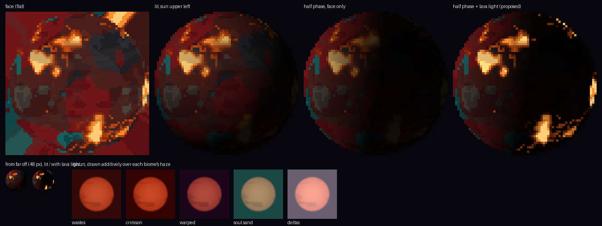

A dark sphere of red rock under ash, the crimson forests a deeper red, the soul sand valleys
ash-brown, the basalt deltas near black, and the warped forests the one cold colour on it, a muted
teal (the forest's own, not the network's lit glow). A few lava seas lie in the low ground with a dark
crust round them, and veins of lava run out from them. Tilted, like Earth, so it reads as a globe.
64 × 64, flat, no lighting baked in; `lit: true`, and a dim ember halo, `glow` `0x7A2E16`.

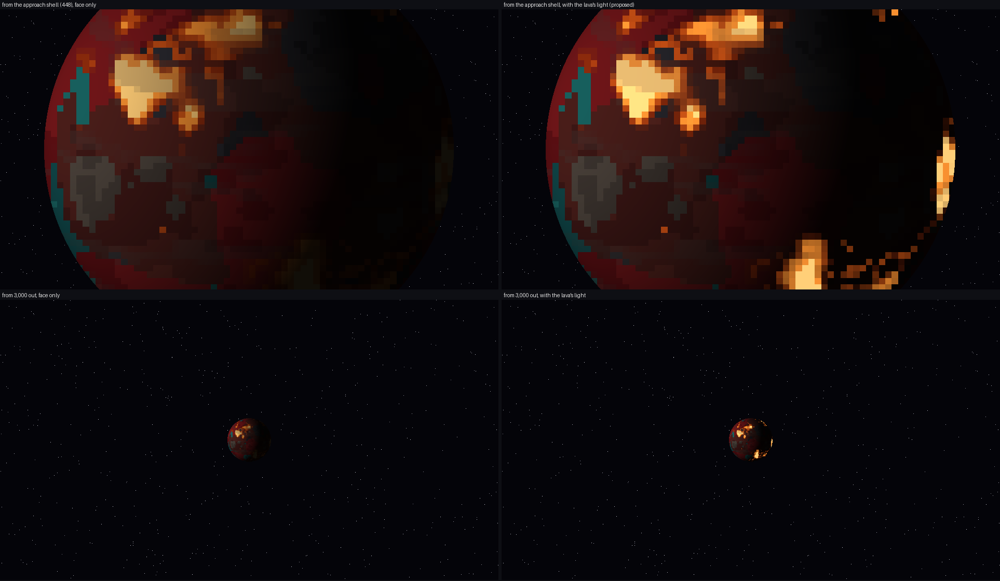

**Proposed (contract section 1):** the lava's own light on the night side. A lit sphere's dark side
goes black, lava and all; a burning world should show its seas glowing there. `nether_glow.png` is
that layer (RGBA, transparent but for the lava), ready. The previews draw it added unshaded and
weighted to the night side. Logic would need an optional `emissive` texture in the space body
format; it is not in the JSON until the format has it.

## 2. The sky and the haze

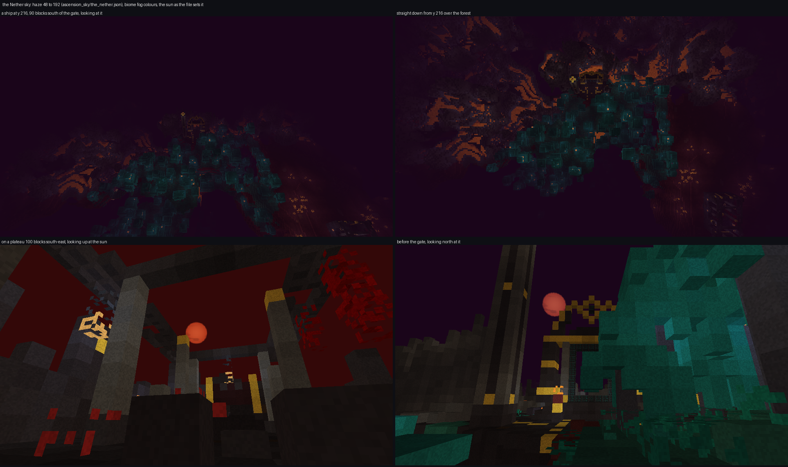

`ascension_sky/the_nether.json`: **haze 48 to 192**, the biomes' own colours (no `color`), and one
body, the sun.

- **48 to 192.** Coming down at y 216 the plateaus are about 110 blocks below. At the placeholder's
  24 to 160 they were all but gone ([compare](../../design/nether/sky-placeholder.png)); at 48 to
  192 the forest, the lava veins in the deltas and the gate's gold crown read through the murk,
  and the ground is clear for the last 48 blocks. 192 is Sanchit's render distance (12 chunks);
  `SkyHaze` clamps to anyone's.
- **The biomes' colours stay.** Dark red over the wastes and crimson forest, near-black purple over
  the warped forest, dark teal over the soul sand valleys, grey over the deltas. They change as a
  ship crosses the biomes, and they are the Nether's identity. (The contract says teal over the
  warped forest; vanilla's warped fog is `0x1A051A`, a purple-black. The teal there is the blocks'.)
- **The sun, smothered.** The Archive's *Ring on Ash* mural shows Planet 3 under "a dim red sun"; it
  hangs there now. `nether_sun.png`: a flat, dull red disc with faint wisps of smoke, drawn by adding
  light (`additive`, `lit: false`), 8 degrees, fixed at yaw 165, elevation 32: north-north-west, so a
  player walking up to the gate's front (it always faces south) sees the sun beside the gold eye.
  Sky bodies are not fogged, so it shows through the haze as a sun through smoke does.
- **Earth and the Moon** are not drawn. Through a haze that hides the ground at 192 blocks, a sharp
  Earth 18,000 out would contradict it; the burning world is a stranded colony.

## 3. The gate ruin

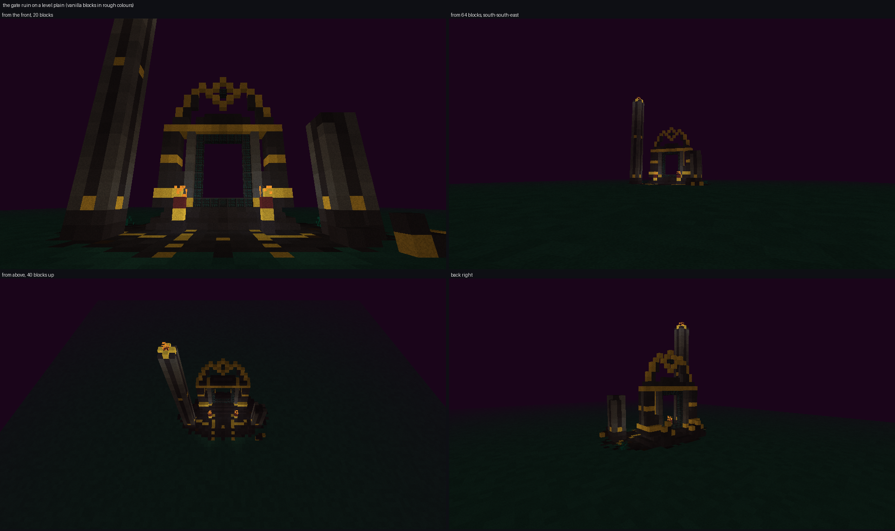
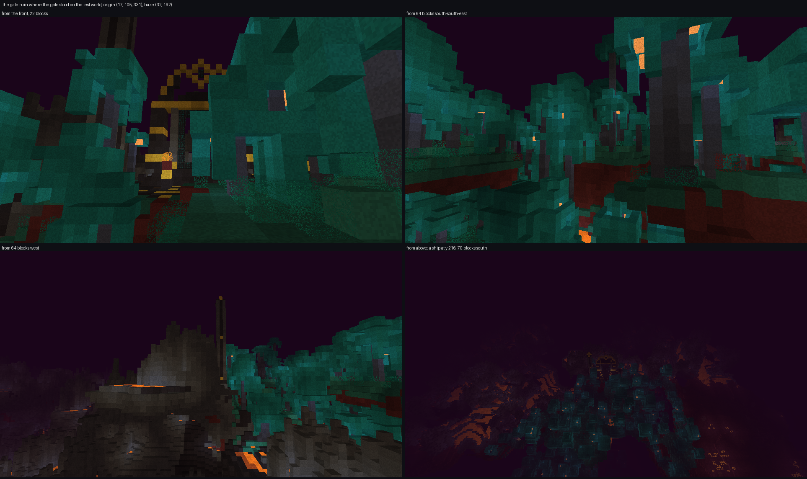

29 wide × 34 tall × 18 deep, `frame_offset [7, 4, 9]`: nine rows of forecourt in front of the frame,
two behind.

| What | Where |
|---|---|
| Footing | site y 0-2, raw blackstone under the whole terrace; y 0 is what pre-generation extends down (through lava too) |
| Terrace | y 3: polished blackstone bricks and polished blackstone, cracked, some gilded; worn to rubble at its rim |
| **The ward ring** | gold set in the terrace all round the gate, an ellipse, a fifth of its stones prised out |
| Avenue | smooth black from the forecourt's edge to the dais, gold studs either side |
| Cleared | y 4-8 over the terrace, and the frame's open cells, so rising ground is cut back |
| **The frame** | `frame_palette`: D polished blackstone bricks, d polished blackstone, **P and C gold blocks** (its courses, its lintel, the floating eye), I polished basalt, `_` polished blackstone brick slabs; its 102 hidden cells raw blackstone |
| Obelisks | two, at the forecourt's front corners: black, basalt corners, gold bands. The west one stands 31 above the terrace with a gold cap and **a fire burning in it**; the east one snapped, its drums and cap across the forecourt's corner |
| Braziers | either side of the avenue before the dais: black pedestal, gold bowl, netherrack burning for ever |
| The forest | warped nylium creeping over the back corners, roots and sprouts on it |
| Back wall | low, broken, gold coping where it survives |

**Gold in the frame tags.** `minecraft:gold_block` joined `#gateway_frame_pale` and
`#gateway_frame_accent` (an Earth player can get it), so the gold frame still passes the check a
player-built one must.

**Why the forecourt, the obelisk and the fire.** The first draft had the frame in the middle of the
terrace and two fungi of its own. Placed on the test seed, the warped forest's giant fungi (features,
generated after structures) crowded right up to it and hid it from 64 blocks and from the air. Now
the frame stands at the back of a deep forecourt, the site plants nothing, and the standing obelisk
clears the canopy: it is the mark from the west and from a ship, and the fire on it is what shows
first through the haze.

**Checked on real worldgen** (fresh world on the first test world's seed, the site generated by the
game): it stood at (17, 105, 331) again, and **4,484 of its 4,585 cells** came out as written. The
rest were overwritten by features afterwards: 77 cleared cells grown full of basalt and 8 of warped
wart from the neighbouring biomes, and **12 of the frame's own back step slabs turned to lava and
magma** by the basalt deltas' lava pools (the ruin stands on the deltas' edge on this seed). That
last one breaks the frame check: see the contract's handover.

## 4. The colonists' ruins

Three whole ruins, one template each, every one opening with the voice's greeting at its door, so
whichever a player finds first begins at the beginning. Finding all three finds all seven.

| Piece | Size (x, y, z) | Plinths, in reading order (template x, y, z, facing) | Stores |
|---|---|---|---|
| `hall_a` the Hall of the Colony | 21 × 16 × 32 | `the_colony` (10, 2, 28) south · `the_ward` (4, 2, 13) east · `the_strongholds` (10, 3, 5) south | none |
| `hall_b` the Granary court | 25 × 15 × 28 | `the_colony` (8, 2, 23) south · `the_gift` (19, 2, 6) south · `the_thieves` (8, 2, 5) south | chest (22, 2, 16) |
| `hall_c` the Forge-house | 23 × 17 × 30 | `the_colony` (11, 2, 25) south · `the_weapon` (8, 2, 16) east · `the_keeper` (11, 2, 6) south | chest (20, 2, 20) |

Coordinates: x across, z from the back (0) to the front, where the player arrives. Floor row 1.

- **hall_a, the Hall of the Colony.** An assembly hall: a nave between two rows of basalt columns,
  its roof fallen in down the middle, the aisles still covered, two tall columns at the door (one
  still capped in gold) as its mark across the plateau. The greeting in the forecourt. **The ward is
  read standing inside a ring of gold set in the west aisle's floor** (the ward motif again). The
  strongholds at the far end on a dais, under the stronghold's sign: battlements in red nether brick,
  the Sealers' fortress brick, between gold posts, since the voice says the fortresses were ours.
  The crimson forest comes in through a breach in the east wall.
  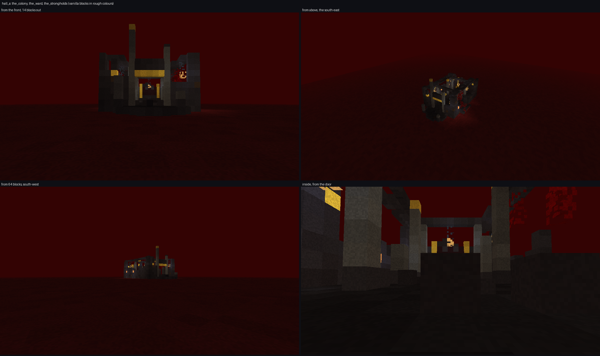 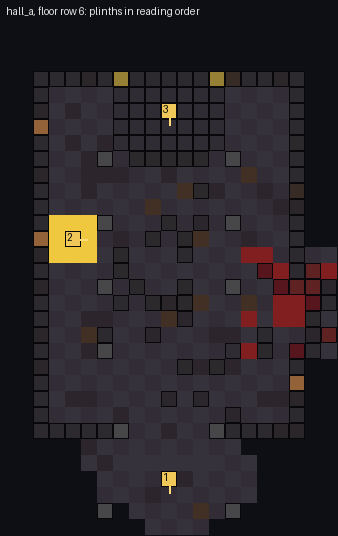
- **hall_b, the Granary court.** A courtyard house by the colony's fields, the crimson forest grown
  into its court round a dry basin rimmed in gold, its bed still hot (magma): "gold like water".
  **On the court's far wall, facing the gate, the colonists' own picture** (`colony_mural`): themselves
  in gold, turning away someone without it. The voice's *thieves* is read in front of it (the crack,
  `the-nether.md`). In the east wing, *the gift* is read before **an uncharged respawn anchor between
  blocks of crying obsidian**, the Openers' answer to the beds that burn; beside it, the stores and a
  corner tower capped in gold.
  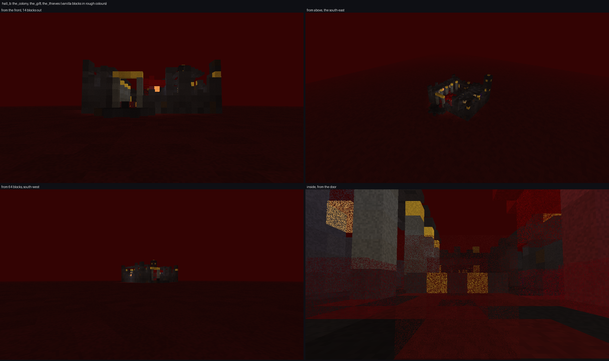 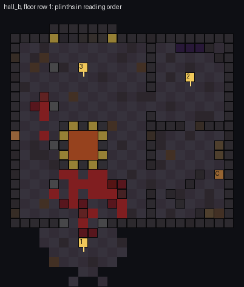
- **hall_c, the Forge-house.** A hearth of lava in a magma bed under a hood on four posts, its flue
  standing over the fallen roof; anvils, a smithing table, a blast furnace, a cauldron of lava, heaps
  of gilded ore. **The weapon is read before the shape the voice taught, laid out in soul sand on a
  dais, waiting for its three skulls.** A player who brings three wither skeleton skulls is
  following the voice's instructions, as the Openers did. The keeper is read at the back before the
  great forge wall (three blast furnaces under a gold-banded hood).
  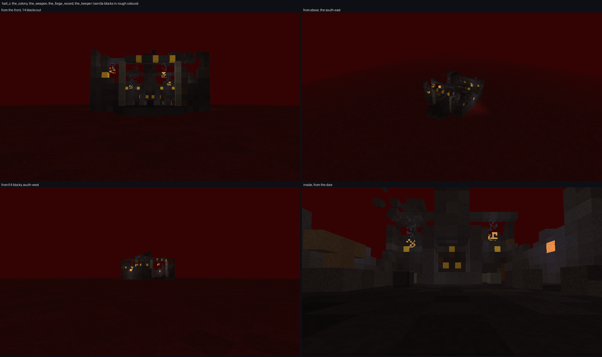 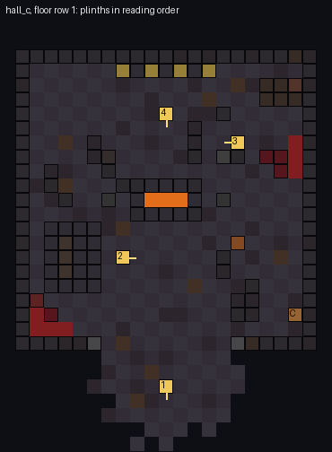

Light is for looks (the Nether spawns at any light): lanterns on chains from the surviving roofs and
beams, shroomlights set in the walls, the magma and the lava.

**The floor is row 1, and they want `terrain_adaptation: beard_thin`.** The first templates had a
six-deep footing for `none`. Placed for real: with `none` the fit swung from good to hanging over
cliffs; with `beard_thin` vanilla levels the ground to a piece's lowest row plus one, so a six-deep
footing stood as a bare podium six above the levelled plateau (every ring column measured −6). With
one row of rubble under the floor, `beard_thin` builds the plateau up to the floor and cuts it away
above. Measured on 23 ruins placed by worldgen in the wastes and crimson forest: **every template
cell present** (the only differences were fungi, weeping vines and mushrooms grown into the ruins
afterwards); on plateaus the ground three blocks round each ruin sat **one below the floor**
(means −1.0 to −1.7), so the paving stands one step proud; three sat in hollows (means +2.8 to
+7.3, banks round them); **one stood on a lava sea at y 31**, which needs logic's ground check (the
handover).

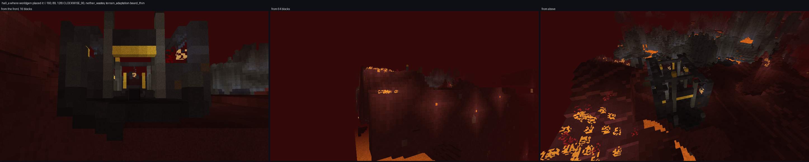
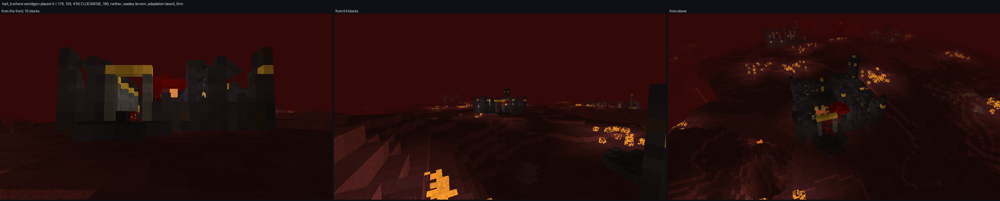
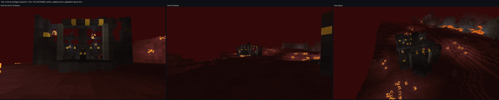

**Keep them out of the basalt deltas** (the contract already says crimson forest and wastes). In a
first test that allowed every biome, the deltas' features grew 1,100 to 2,700 basalt blocks into a
ruin and poured lava through its floor.

## 5. The Sealers' carving

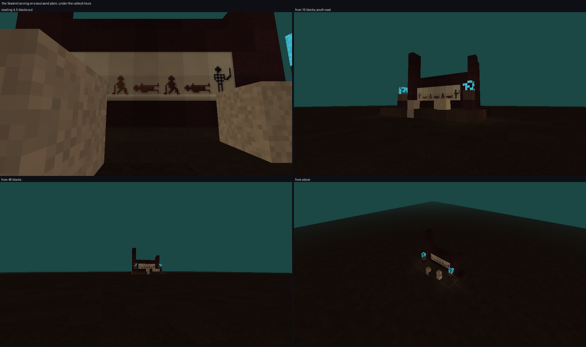
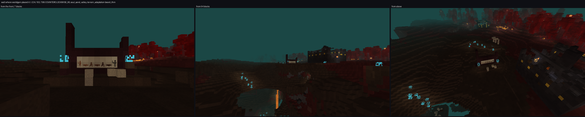

`sealer_carving/wall`, 13 × 11 × 7: a wall the Sealers raised on the battlefield, in their fortress
brick (nether bricks, cracked, chiseled at the piers' heads, the east pier broken), two thick so its
picture's back never shows. Across it, at eye height, **`the_returned`**: one soldier, seven times,
left to right, standing with his blade, fallen; rising, fallen; rising, fallen; then standing as a
black skeleton, taller than the man was, his blade in hand. Each return is inlaid in darker stone
than the last. Before it, the Sealers' fire, soul fire burning on soul soil in two brick bowls; the
battlefield's bones half-sunk in the court. No plinth: the voice has nothing to say about it.

Placed by worldgen 19 times in the soul sand valleys: every cell present (four soul fires and a root
grew in), the ground level round it on ridges; two on lava seas, as with the ruins.

## The blocks

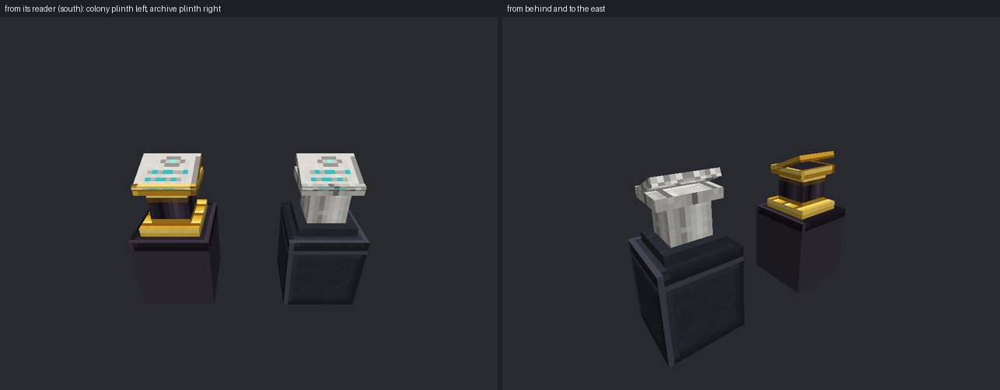
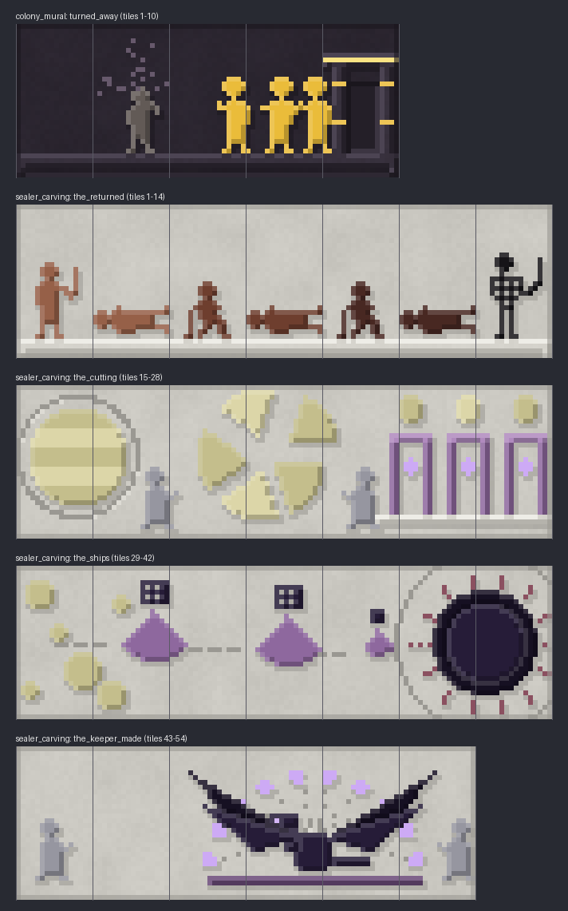

| Block | New | Look |
|---|---|---|
| `colony_plinth` (logic's) | | the archive plinth's shape exactly (so its collision box fits): colony stone base, a gold foot ring, a dark fluted column ringed in gold, a gold-rimmed desk; the tablet is the voice's own (`archive_tablet_face`), its edge set in gold. Lang *Colony Plinth* |
| `colony_mural`, `tile` 0-10 | yes | the colonists' carving, gold-figure on black: tile 0 bare stone; 1-10 *turned_away* (5 × 2). Lang *Colony Mural* |
| `sealer_carving`, `tile` 0-14 | yes | the Sealers' plaster, cut with the Archive's own `Canvas`: tile 0 bare plaster; 1-14 *the_returned* (7 × 2). Lang *Sealers' Carving* |

Both pictures are one block with a `tile` property and a model per tile, as the Archive's murals are:
the tile on four sides, tile 0 on the ends, loot keeping the tile (`copy_state`), mined with a
pickaxe (`#ascension_worlds:nether_decor`), in the building-blocks tab. `ColonyMuralBlock.TILES` and
`SealerCarvingBlock.TILES` must match the art script's catalogues; it refuses to run if they differ.
`NetherDecorBlocks.register` is one line in `AscensionWorlds`, as the Archive's decor class is.

**The colonists draw the other way round from the Sealers.** Sealer pictures are black-figure, dark
inlay on pale plaster. The colonists cut theirs in their dark stone and inlaid the figures in gold,
because gold was what they were; the one without gold is ash-grey, the rot drifting off it as dull
specks.

New palettes, in the scripts: `N_RACK`, `N_CRIMSON`, `N_WARPED`, `N_SOUL`, `N_BASALT`, `N_LAVA`,
`N_ASH`, `N_SUN` (the sky script: the planet and its sun); `COLONY` (the colony's dressed black stone),
`GOLD` (beaten gold, a metal: specular top, dark foot), `ASHEN`, `ROT`, `RETURNED` (the art script).
None is teal but `N_WARPED`, the forest's own muted teal.

## How it was checked

- **The generators check the contract before writing.** The site never touches a frame cell, keeps
  the opening's approach clear, and every `frame_palette` block is in its symbol's tag. Each ruin has
  two or three plinths, `the_colony` nearest its front, each on a full block facing a cell a reader
  can stand in; all seven ids appear; chests name `nether_colony/stores`; lava cannot flow out of the
  hearth; pieces fit 48³. The carving holds every tile and no tile face shows a mirrored picture.
- **Reproducible:** every generator run twice changes no file.
- **Placed for real**, on a dedicated dev server with the full mod stack, in fresh worlds on the first
  test world's seed (-4091187734703303684). A throwaway datapack (never committed) stood in for
  logic's worldgen: single-piece jigsaw structures, `start_height` −1 projected to
  `WORLD_SURFACE_WG`, `terrain_adaptation` `beard_thin`, the ruins in the wastes and crimson forest,
  the carving in the soul sand valleys, dense random spreads. About 1,400 chunks were generated and
  read back with `template_fit.py` (numbers above, and in sections 3 to 5).
- **The views are of real ground.** `render-nether-views.py` ray-marches the generated chunks with
  the haze, the biome's fog colour, the Nether's block light and its lightmap (vanilla's
  `LightTexture` formula, at the default gamma). Vanilla blocks are drawn in rough colours with a
  little noise, never from vanilla's textures; our own blocks from their own textures.
- `./gradlew :modules:worlds:build` passes. Every model resolves.

## What the format could not express

- **The lava's light from space**: an `emissive` layer on a space body (proposed; the texture is ready).
- **Keeping features off a structure.** Fungi grow over the ruins and the gate (that reads as the
  forest reclaiming them, and is fine); the deltas' lava pools overwrote frame cells (not fine; the
  handover).
- **The ruins' rotation.** A jigsaw start is placed in a random rotation; every ruin reads from any
  side it is approached from, and its door is wherever it lands.

## Live checklist (ADR-0008)

On a dedicated server and in a client, on a fresh world:

- [ ] From space, the Nether is the dark red sphere with lava and teal patches, lit into a phase,
      its ember halo on the lit limb; its lava glows on the night side (`emissive`, added by logic).
- [ ] Coming down at y 216: the ground reads through the haze; the biome's colour overhead changes
      as the ship crosses biomes; the haze never ends short of the render distance's fog edge.
- [ ] The sun hangs dim and red in the north-north-west in every biome, unfogged, and is hidden
      in lava and under blindness; it never moves (the Nether's time is fixed).
- [ ] Distant Horizons: its LODs past the vanilla render distance either match the haze or are off
      in the Nether (DH draws its own fog; not seen yet).
- [ ] The gate ruin: on its terrace, gold ring and avenue clear, frame in black and gold, the
      obelisk's fire burning, the braziers lit, nothing floating; the field and the walk-in clear;
      the Monstrosity's key attunes it (only after logic's fix where the deltas border it).
- [ ] The gate's frame cannot be broken in survival, by hand, explosion or piston ("The ancients
      built this gate to last."), while its terrace and decoration can (logic's change, 2026-10-11,
      replacing the stripped-frame check).
- [ ] Each colony ruin generates in the wastes and crimson forest on a plateau, the paving one step
      proud, never on a lava sea; its tall mark visible over the plateau's rim.
- [ ] Every plinth reads its tablet upright, gold-edged, from the cell in front of it; the colony
      plinth's collision matches its model; each opens its own entry.
- [ ] hall_b: the colonists' picture reads left to right from the court, gold figures and the grey
      one clear at 3-5 blocks, in every start rotation; the respawn anchor charges and works.
- [ ] hall_c: the hearth's lava stays in its bed; the soul sand shape takes three wither skeleton
      skulls and wakes a Wither (the voice's recipe, followed).
- [ ] The stores chests roll `nether_colony/stores`.
- [ ] The Sealers' carving reads left to right from its court in every rotation; its soul fire
      burns; piglins keep away from it.
- [ ] `colony_mural` and `sealer_carving` mine, drop with their tile, and go back up as the same
      picture; both are in the creative tab.
- [ ] Persistent across a world unload and reload: plinth entries, chest loot already rolled.
