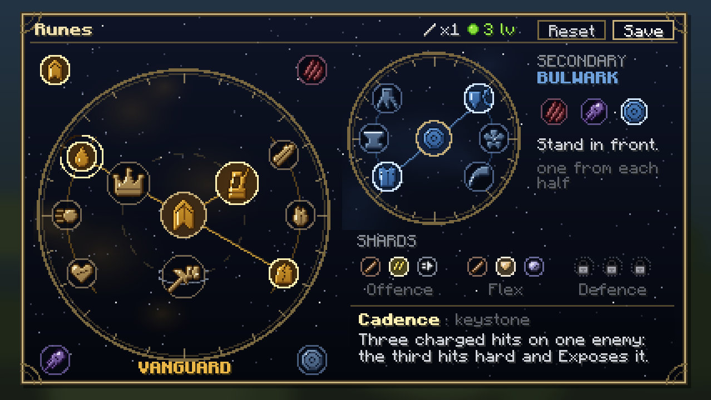

# The rune system

> **Design, 2026-10-15**, by the rune session. Built on the research in
> [`docs/progression/rune-research.md`](../progression/rune-research.md) and the keystone
> brainstorm in [`keystone-ideas.md`](../progression/keystone-ideas.md). The structural choices are
> in [ADR-0020](../decisions/0020-rune-pages.md). **Sanchit's answers of 2026-10-15 are in §13**;
> what is still open is marked there.
>
> Replaces `combat-api.md` §7. Every number is a placeholder (`combat-api.md` §3): Sanchit balances
> by playing, and every number lives in a data file.

## 1. In short

- **Four paths:** Vanguard, Reaver, Aetherwright, Bulwark. Each has **three keystones**: two for
  combat and one **world keystone** for the rest of Minecraft (vein mining, stealth past the Warden,
  more XP, creepers that keep away). Then **two rows of three minors**. 36 runes; 5 built today.
- **A page:** a primary path (one keystone, one minor from each row), a secondary path (one minor
  from each of its rows) and three **stat shards**.
- **Slots open as you grow**, through growth's milestones. Every rune can be tried from the start.
- **Changing costs something:** removing or replacing a rune uses a **Rune Chalk and some XP
  levels**, out of combat. Filling an empty slot is free.
- **Four runes grow** over the game, to a cap. Swapping one out loses its growth.
- **Runes are data.** Each rune's numbers are a JSON file the client also receives.
- **A real screen, the orrery:** each path a brass dial on a night sky, keystones round its hub
  and minors on its rim. Emblems, an icon per rune, hover cards, motion and sound (§10).

## 2. Where runes fit

| Layer | Its job | Owner |
|---|---|---|
| **Growth** | Permanent numbers: you get stronger over the game | Growth session (`growth.md`) |
| **Items** | What kind of fighter you are | Combat items, stats session (`item-stats.md`) |
| **Runes** | **How you play**: behaviours you commit to | This doc |

**The boundary with growth:** growth is numbers and permanent; runes are behaviours and swappable.
The skill tree never holds procs. Runes give plain stats in two places only, both lost when you
change them: stat shards, and the four growing runes (§4.5).

**World keystones are behaviours, never growth's numbers.** Growth's Wayfarer arm gives exploring
stats (speed, mining speed, safe falls, reach). A world keystone does something else entirely:
breaks a vein, silences your steps, sends creepers away.

**Stats** are given and read only through the stats session's API (`item-stats.md` §6): runes add
attribute modifiers under a prefix registered with `StatSources` (`ascension_combat:rune/`, shown
as "Runes" on the character sheet), and read every stat through `StatReader.value`. There is no
base/bonus split (Sanchit, 2026-10-15): a rune that scales off Attack Damage reads the total.

## 3. The page

| Part | Picks | Rules |
|---|---|---|
| **Primary path** | 1 keystone + 2 minors | One of the path's three keystones. One minor from each of its two rows. |
| **Secondary path** | 2 minors | Any other path. One minor from each of its two rows. No keystone. |
| **Stat shards** | 3 | One from each row: offence, flex, defence. |

That is **eight picks**, against League's nine and today's five. Two rows rather than League's
three, because Minecraft has fewer combat verbs and filler was League's worst lesson (research §2).

**What the server checks** before saving a page (the client is never trusted):
- the primary path is set; the secondary, if set, is a different path;
- the keystone belongs to the primary path;
- each minor belongs to its side's path, at most one per row;
- each shard belongs to its row;
- every slot used is open to this player (§6);
- the player is out of combat, and pays the cost if a rune was removed or replaced (§7).

A page may be left part-empty. An empty slot is simply nothing.

## 4. The four paths

Each path has a colour, an emblem and a one-line promise. Colours avoid teal (the gateway network's,
`art-guide.md`).

| Path | Promise | Colour | Plays like | World keystone |
|---|---|---|---|---|
| **Vanguard** | *Keep hitting.* Damage that grows the longer you fight. | Forged gold | A duellist who wins long fights | Vein Breaker |
| **Reaver** | *Strike first, finish fast.* Burst, ambush, the long shot. | Crimson | A hunter who picks the moment | Silent Step |
| **Aetherwright** | *Make the magic do more.* Stars and lightning from your weapon. | Violet | A fighter whose weapon does the casting | Scholar |
| **Bulwark** | *Stand in front.* Defence, pets, the team. | Steel blue | The one the others stand behind | Cat's Eye |

**World keystones are meant to be hard to give up** (Sanchit: make them good enough that choosing
hurts). Each is strong for how you live in the world, and taking one costs you that path's combat
keystone. On the screen they stand **apart** from the two combat keystones, in their own socket
shape, so the choice is plain.

Status: **Built** (exists today), **New**. **Grows** marks the four growing runes (§4.5).

### 4.1 Vanguard: keep hitting

| Slot | Rune | What it does | Placeholder numbers | Status |
|---|---|---|---|---|
| Keystone | **Conqueror's Resolve** | Every second in combat you gain a stack. Each stack gives Attack Damage and omnivamp. Stacks clear when the fight ends. | 10 stacks; +0.5 AD and +1% omnivamp each | Built |
| Keystone | **Cadence** | Land three **fully charged** hits (melee at full swing, or fully drawn arrows) on one enemy within 4 s. The third deals bonus damage and **Exposes** it: it takes more damage from everyone. | +3 physical; Exposed: +10% damage taken for 5 s | Built |
| World keystone | **Vein Breaker** | Mine an ore or a log **while sneaking**, and the connected blocks of the same kind break with it. Each costs the tool's durability and a little hunger. | Up to 32 blocks | Built |
| Row 1: *how do you stay in the fight?* | **Second Wind** | Regenerate while in combat and below half HP. | 1 HP a second | Built |
| | **Momentum** | Chaining hits quickly builds stacks; each stack heals you for a share of the damage you deal. | 5 stacks, 2 s to chain; 1% per stack | Built |
| | **Blooded** *(grows)* | Omnivamp that grows with every new kind of enemy you defeat. | +0.5% per kind, up to +6% | Built |
| Row 2: *how does your damage grow?* | **Relentless Strikes** | Hits build a stack that fades if you stop. Each stack adds damage to every hit. | 4 stacks, +0.75 physical each, 3 s to fade | Built |
| | **Killing Surge** | A kill gives a burst of attack speed. | +20% for 3 s | Built |
| | **Giant Slayer** | More damage to enemies with more max HP than you. Bosses. | +5% at 10% more HP, up to +15% at double | Built |

### 4.2 Reaver: strike first, finish fast

| Slot | Rune | What it does | Placeholder numbers | Status |
|---|---|---|---|---|
| Keystone | **Ambush** | Hits on an enemy **that isn't targeting you** deal much more damage, more still if critical. Sneak up on things; weak against bosses, which always see you. | +40%; +20% more on a critical hit | Built |
| Keystone | **Deadeye** | An arrow that lands near the head is a **headshot**: bonus damage, more the farther the shot. A clear "ding". | +50%, then +2% per block past 10, up to +100% | Built |
| World keystone | **Silent Step** | You make **no vibrations**: sculk sensors and shriekers never hear you, so the Warden isn't called. Sneaking, mobs only notice you close up. | Noticed within 6 blocks | Built |
| Row 1: *how do you open?* | **Pounce** | Your critical (falling) hits hit harder. | Crit multiplier 1.5 → 1.75 | Built |
| | **Drop In** | For a few seconds after a dash, blink, ender pearl or a fall of 4+ blocks, you cut through armour. | +10 Lethality, +10% penetration for 4 s | Built |
| | **Vanish** | A kill makes you invisible for a moment, and mobs nearby lose track of you. | 2 s; 10 s cooldown | Built |
| Row 2: *how do you finish?* | **Finishing Blow** | More damage to enemies below 40% HP. | +12% | Built |
| | **Overkill** | Damage beyond what a kill needed splashes onto the nearest enemy. | Within 4 blocks, up to 6 damage | Built |
| | **Trophy Hunter** *(grows)* | Lethality that grows with every new kind of enemy you defeat. | +1 per kind, up to +12 | Built |

### 4.3 Aetherwright: make the magic do more

ADR-0012 rules out spells. Magic damage comes from procs: a few combat items' (Ragefang, Darken
Blade, Heartwood of Pallas, Unending Despair), and this path's own. **Both combat keystones make
their own magic damage**, so the path works with any weapon and grows with the magic items.

| Slot | Rune | What it does | Placeholder numbers | Status |
|---|---|---|---|---|
| Keystone | **Starfall** | A fully charged hit, or any magic damage you deal, calls a star down on the target. It lands a second later and hurts everything near it. Magic hits shorten its cooldown. | 4 + 20% of AD, magic, 2-block radius; 10 s cooldown, −1 s per magic hit | Built |
| Keystone | **Arc** | Every fourth hit charges your weapon. The next hit releases lightning that jumps between enemies. Using an item's active fully charges it. | 3 + 15% of AD, magic, up to 3 jumps within 5 blocks | Built |
| World keystone | **Scholar** | More experience from everything, and enchanting costs a level less. (The lore says the Observers are generous with those who enchant.) | +50% XP; enchanting −1 level, never below 1 | Built |
| Row 1: *what makes your magic hit harder?* | **Attunement** | All your magic damage is stronger. | +12% | Built |
| | **Unweave** | Your magic damage ignores part of Magic Resist. | 15% | Built |
| | **Clarity** | While above 70% HP, more Attack Damage and magic damage. | +1 AD, +8% magic | Built |
| Row 2: *what does your magic give back?* | **Siphon** | Heal for part of the magic damage you deal. | 10% | Built |
| | **Quickening** | Items' active abilities recharge faster. | 20% faster | Built |
| | **Gathering Charge** *(grows)* | Magic damage that grows with every new kind of enemy you defeat. | +1% per kind, up to +12% | Built |

### 4.4 Bulwark: stand in front

**Allies** are other players and your tamed pets near you, found when something happens (an event),
never by scanning every tick. So the team runes still do something for a solo player with a wolf.

| Slot | Rune | What it does | Placeholder numbers | Status |
|---|---|---|---|---|
| Keystone | **Brace** | Block a hit with a shield, or take a big hit, and you brace: huge Armor and Magic Resist for a moment, then a shockwave that hurts and throws back everything near you. | Big hit: 25% of max HP. +40 Armor and Magic Resist for 2.5 s; shockwave 3 + 10% of your Armor, magic, 4 blocks; 12 s cooldown | Built |
| Keystone | **Pack Leader** | Your tamed wolves, cats and parrots share your defences, hit harder, and heal when you heal. Once every few minutes, a pet that would die is saved at 1 HP and brought to you. | 50% of your Armor and Magic Resist; +3 damage; 25% of your heals; save every 3 minutes | Built |
| World keystone | **Cat's Eye** | **Creepers and phantoms keep away from you**, as they do from cats. (The lore says cats can see the Observers; this lends you that sight.) The price: hard to hunt creepers for gunpowder. | Creepers flee within 6 blocks; phantoms never swoop at you | Built |
| Row 1: *how do you take a hit?* | **Plating** | After a hard hit, the next few hits are softened. | After 4+ damage: next 3 hits within 3 s take 30% less; 12 s cooldown | Built |
| | **Unbowed** | Harmful effects on you wear off sooner, and knockback moves you less. | 30% shorter; 40% less knockback | Built |
| | **Deep Roots** *(grows)* | Max HP that grows with every new kind of enemy you defeat. League's Overgrowth, Sanchit's example. | +0.5 HP per kind, up to +6 | Built |
| Row 2: *what does your defence give back?* | **Riposte** | Raise your shield just as a hit lands (a parry): the attacker is stunned and your next hit is a critical. | Within 0.5 s of raising it; stun 1 s; crit within 2 s | Built |
| | **Revitalize** | Heals and shields you give or receive are stronger, more so on someone low. | +10%; +20% below 40% HP | Built |
| | **Challenge** | Mobs you hit keep attacking you instead of your allies, pets or villagers. | 4 s | Built |

**No oxygen keystone** (Sanchit, 2026-10-15: "I don't even know if we want an oxygen type
keystone"). The Bulwark oxygen tie-in in `combat-api.md` §7 is dropped, and its open question in §9
there is closed with it. The ideas that came out of it (Lifeline, Deep Lungs) are kept in
`keystone-ideas.md`.

### 4.5 Growing runes

Sanchit asked for runes that "grow as the game goes, till a cap", where changing one loses that
progress, so that changing is a choice with a price. **Four runes grow**, one per path: Blooded,
Trophy Hunter, Gathering Charge and Deep Roots.

- **They grow from new kinds of enemy:** each kind of hostile mob you defeat while the rune is on
  your page counts once. Bosses count. **A mob farm can't fill it**, because a zombie is one kind
  however many die; exploring new places does.
- **The cap is 12 kinds.** Earth's nights alone hold more than 12 kinds, so a player reaches the
  cap through play, not grinding.
- **Swap it out and it starts again.** The screen shows its growth as a ring filling round its
  socket, and asks before a swap throws it away: "Lose 9 of 12?"
- **Kept through death and logout.** Only changing the rune resets it.

## 5. Stat shards

Small plain stats, out of the paths' way (research §2, lesson 4). All three together are worth
about **one boss's growth** (`growth.md` §8), so a full page never outweighs progress.

| Row | Choices |
|---|---|
| **Offence** | +1 Attack Damage · +8% Attack Speed · +3% Move Speed |
| **Flex** | +1 Attack Damage · +5 Armor · +5 Magic Resist |
| **Defence** | +2 HP · +5 Armor · +5 Magic Resist |

## 6. Unlocks: slots open, runes don't

**Decided** (Sanchit, 2026-10-15): every rune can be chosen from the first minute. What opens with
growth is the page's **slots**:

| When | What opens |
|---|---|
| **From the start** | The primary path: any keystone, both minors |
| **1st milestone** | The secondary path |
| **2nd milestone** | The offence shard |
| **3rd milestone** | The flex shard |
| **4th milestone** | The defence shard |

- **A milestone is whatever growth counts** (`growth.md` §3: a boss's first kill, a lit gate). The
  rune side reads a number through growth's public API, `com.ascension.combat.api.growth`. That
  hook is agreed through Sanchit.
- **No world is ever needed** (ADR-0018): any milestone counts, in any order.
- **A locked slot is shown**, dark with a padlock, and its card says what opens it.
- **Until growth is merged**, a server config switch (`runes.unlocks`: `all` or `progressive`)
  defaults to `all`.

## 7. Changing runes

**Decided** (Sanchit, 2026-10-15): out of combat, and **removing or replacing a rune costs one Rune
Chalk and some XP levels**, so nobody swaps on the spot.

- **Filling an empty slot is free.** A new player's first page, and every slot growth opens, cost
  nothing.
- **The cost is paid once per save**, however many runes change in it: one Rune Chalk and 3 levels
  (placeholder). The Save button shows the cost before you press it.
- **Rune Chalk** is a new item, crafted from Earth materials: an amethyst shard and calcite make 2
  (placeholder recipe). Both come from geodes, so it asks a little exploring, never another world.
- **In combat**, the screen opens but saving is refused, with the reason on screen.
- **Nothing is saved until Save.** **Reset** returns to the saved page.
- A change takes effect at once. Stacks from the old page are cleared, and a removed growing rune
  loses its growth (§4.5).
- Saved pages (named loadouts) would undercut the cost, so they are not planned.

## 8. Effects: what a player sees

Research §2 lesson 5: a rune you can't feel might as well not exist.

- **Every keystone shows when it fires**: particles in its path's colour, and a vanilla sound.
  Starfall's streak, Cadence's third hit, Deadeye's ding, Brace's shockwave ring, Arc's jumps.
- **Stacks you build** (Conqueror's) show as a small counter beside the hotbar, using the screen's
  art. One HUD element for every rune, not one each.
- **Exposed** is a timer on the target, not a vanilla mob effect: the Wither and Cataclysm's bosses
  refuse effects (Grievous Wounds found this first), and Cadence matters most against exactly
  them. So the rune draws its own particles on the target when it lands. Cadence's data sets how
  strong (`exposed_amplify`, 10%) and how long (`exposed_seconds`); a second Exposed never weakens
  a stronger one (`ExposedState`).

## 9. How it's built

### Runes are data

Every rune is a JSON file in a datapack registry, `ascension_combat:rune`, synced to clients the
way planets are (`AscensionWorlds`' `DataPackRegistryEvent.NewRegistry`):

```json
// data/ascension_combat/ascension_combat/rune/cadence.json
{
  "path": "vanguard",
  "slot": "keystone",
  "position": 1,
  "icon": "ascension_combat:rune/cadence",
  "effect": "ascension_combat:cadence",
  "values": { "hits": 3, "window_seconds": 4, "bonus_damage": 3.0,
              "exposed_seconds": 5 }
}
```

- **`effect`** names the Java behaviour (one listener class per behaviour, as today). A datapack can
  make a variant with different numbers, or remove a rune, with no code.
- **`values`** are the numbers. The behaviour reads them from the rune; the hover card prints them.
  Retuning is a JSON edit.
- **Slots:** `"keystone"` (with `"world": true` for a world keystone), `"minor"` with
  `"row": 0 | 1`, or `"shard"` with `"row": 0 | 1 | 2` (offence, flex, defence). `"position"` 0 to
  2 is its place in the row.
- **Growing runes** add `"growth_cap": 12`; their values are per kind.
- **`icon`** is a GUI sprite: `ascension_combat:rune/cadence` is
  `textures/gui/sprites/rune/cadence.png`, with `_open` for the dimmed state; a shard's is
  `shard/<stat>`. A pack can override any sprite.
- **`numbers`** are the card's lines of numbers, each read from the rune's own `values`:
  `{ "text": "<lang key with %s>", "parts": [ { "value": "hits", "format": "plus", "stat": "attack_damage" } ] }`.
  Formats: `plain`, `plus`, `percent`, `plus_percent`, `over_percent`; `stat` colours the number.
  A line that names a value the rune lacks, or an unknown stat, fails the file (reported by name).
- **A shard's effect** names the stat it gives, `ascension_combat:shard/<stat>`, and its `amount`
  is written as a player says it (8 is +8% Attack Speed): a shard for any stat is a data file.
- **Text** is in the lang file: the name (`rune.<ns>.<id>`), one plain sentence (`.desc`, no
  numbers: the card's lines carry them), and for a keystone a one-line `.blurb` for the box.

### The page

`RunePageState` (an attachment, saved with the player, as today) gains the keystone, the shards and
each growing rune's kinds (a small set of entity-type ids, at most 12). Old saves load: a missing
keystone becomes the path's first, missing shards stay empty.

Payloads: `SetRunePagePayload` (client → server) carries the whole page. A new
`RunePageResultPayload` (server → client) says saved, or refused and why. `RunePageSyncPayload`
(server → client, on login and after a save) carries the page and growth.

### Performance (ADR-0007)

- **No collection outside an attachment** holds a player or an entity. Fight-local state (stacks,
  cooldowns) lives in player attachments and is cleared on logout and death.
- **No per-tick scans.** Listeners are per event. The few per-player tick checks (Conqueror's) leave
  at once unless the player has that rune.
- **Allies and pets** are found on the event that needs them, within a radius.
- **Vein Breaker** walks at most 32 connected blocks, once, on the break event.
- **Cat's Eye** adds one avoid goal to each creeper as it joins the world, the same kind vanilla
  gives creepers for cats.
- **Starfall's delayed strike** is a game time stored on the player, resolved on their next tick.

### API (`com.ascension.combat.api.rune`)

- `RunePath` (today), plus a read-only `RunePages.get(Player)`: path, keystone, minors, shards.
- A `RunePageChangedEvent` on the NeoForge bus, for other mods.
- Rune behaviours stay internal in v1. Letting other mods add behaviours is a later API change.

## 10. The screen: the orrery

**Chosen by Sanchit, 2026-10-17.** The first mockups put the page in League's two columns, and he
turned them down on 2026-10-16: "its kinda exact copy of the layout for the runes". Four other
layouts followed (a rune pouch like Minecraft's inventory, a loadout round the player, an orrery,
a sky map of constellations; commit `3773f06`). He chose the orrery. The mockups are in
`design/runes/`, made by `tools/generate-rune-art.py`.



### The layout (400 × 224 GUI pixels)

- **The primary path is a brass dial** on the left.
  - Its **hub** is the path's emblem.
  - Its **three keystones** sit on an inner ring: the two combat keystones above the hub, and the
    world keystone below it, in a socket with an orbit round it, so it stands apart.
  - Its **six minors** sit on the outer ring: row 1 on the left half, row 2 on the right half,
    each half traced by a faint arc in the path's colour.
  - **Spokes** of light run from the hub to the chosen keystone and the two chosen minors.
  - The **four path tabs** sit in the dial's corners. Choosing one turns the dial to that path.
  - The path's name sits under the dial, and a faint cloud of its colour behind it.
- **The secondary path is a smaller dial** to the right: hub, six minors, two spokes. Its three
  tabs sit beside it, with its promise and "one from each half". Before the first milestone it is
  dark: an empty ring, a padlock in the hub, "Opens at your 1st milestone".
- **The shards** are three rows of three small moons below it: offence, flex, defence. A locked row
  shows padlocks.
- **The keystone box** at the bottom right says what the chosen keystone does, in one sentence.
- **The title bar** holds Save and Reset, and the cost of this save: a Rune Chalk and 3 levels, or
  "free" when the save only fills empty slots.

### What it must do

- **Readable at GUI scales 2 to 4:** the panel is 400 × 224 GUI pixels, inside the 426 × 240 a
  720p screen gives at scale 3 (`design/runes/orrery-fit-gui-scales.png`). Pixel art at one texel
  per GUI pixel: sharp at every scale.
- **Four states**, told apart by brightness and the socket, not only colour:
  - **chosen:** a bright star in a halo;
  - **open:** a thin ring of starlight, the icon desaturated;
  - **not allowed:** a ring of dust;
  - **locked by growth:** a ring of dust with a padlock.
  Growing runes add a ring that fills as they grow.
- **Hover cards** (`design/runes/orrery-hover.png`): a nine-sliced panel beside the rune, kept on
  screen. Name, path and slot, one plain sentence, the numbers coloured by stat, the fine print
  (conditions, and what a swap would cost), and for a locked slot what opens it.
- **Motion**, in whole-pixel steps:
  - choosing a primary path turns the dial a quarter round to it (250 ms, eased);
  - the spokes draw out from the hub (150 ms);
  - a socket brightens on hover;
  - the chosen keystone's halo breathes slowly.
- **Sound** (vanilla sound events, played as UI sounds): a quiet tick on hover, a chime on choosing
  pitched per path, a heavier one for a keystone, a dull note when refused, a seal on Save.
- **Opened with R**, bound by default (growth's tree takes K).

### The art kit, shared with growth

The night sky in a brass frame, the dial rims, the star sockets, the cards, the buttons and the
sounds are one kit, made by one script. Growth's skill tree (`growth.md` §10) is to reuse it, so
the two screens are one game.

- **From `tools/generate-rune-art.py`:** 4 path emblems, 36 rune icons, 6 shard icons, the
  sockets in each state, the panel, the hover card, buttons, the padlock, the growth ring, and the
  Rune Chalk item.
- **Shape language per path:** Vanguard heavy and upright (a banner, a crown); Reaver sharp and
  leaning (claw marks, a dagger); Aetherwright round and orbiting (a comet, stars, a spiral);
  Bulwark broad and closed (a shield, a paw, an anvil).
- **No accidental symbols** (no crosses, letters or faces), and no teal or diamond eye: those are
  the network's. The review caught a pick that read as a hammer and sickle, a tally that read as a
  "Y", a boot that read as an "L", and an orb that came out as a diamond; all redrawn.

## 11. Requested stats

For the stats session, through Sanchit (`combat-api.md` §3, "Requested stats"):

| Stat | For | Until it exists |
|---|---|---|
| **Tenacity** | Unbowed: shorter harmful effects, less knockback | The rune does it itself |
| **Heal and Shield Power** | Revitalize | The rune does it itself |
| **Item Haste** | Quickening | The rune does it itself |

None blocks the runes. Each would also be worth an item later, which is why it belongs in the stat
model rather than inside a rune.

## 12. Increments

Each ends seen in Sanchit's client (ADR-0008); anything touching world state also on a dedicated
server; anything saved, across a world reload.

| # | What | Seen working when |
|---|---|---|
| **R1** | **The page:** the rune registry and its JSON, the new page shape (keystone choice, rows, shards), validation, the in-combat rule, the cost (Rune Chalk and XP), the result payload. Vanguard moved to data. The old screen made to drive it. | A page saved on a dedicated server survives a reload; a change in combat, or without chalk, is refused with a reason. |
| **R2** | **Vanguard:** Cadence, Vein Breaker, Blooded (and growth), Giant Slayer. *Built 2026-10-17 and tested in play by Sanchit the same day ("all working").* | Each fires, with its effect visible; Blooded's growth survives a reload and resets on a swap. |
| **R3** | **Refactor pass** (ADR-0008). *Done 2026-10-17.* | |
| **R4** | **Reaver** and **Aetherwright**. *Built 2026-10-17: all 18 runes load on a dedicated server, the arithmetic and bookkeeping are unit-tested; the effects themselves wait for Sanchit's play.* | Each rune fires. Silent Step walked past a shrieker. |
| **R5** | **Bulwark** and the stat shards. *Built 2026-10-17 (the shards earlier, with the screen): 45 runes in all load on a dedicated server; the effects wait for Sanchit's play.* | Pack Leader with a wolf; Cat's Eye with creepers. |
| **R6** | **Refactor pass.** | |
| **R7** | **The screen: the orrery** (§10): dials, cards, motion, sound. *Built 2026-10-17 and photographed in a client at GUI scales 2, 3 and 4 (`design/runes/in-game/`); the HUD stack counter is not built yet (it needs the stack counts synced to the client).* | At GUI scales 2, 3, 4. |
| **R8** | **The art:** every icon, emblem and frame from the generator. *Built 2026-10-17: 181 GUI sprites, `design/runes/kit.png`.* | In the screen, at all three scales. |
| **R9** | **Unlocks**, once growth's API is merged. | Slots opening as milestones land, on a dedicated server. |
| **R10** | **Refactor pass.** | |

**Re-sequenced 2026-10-17 (Sanchit):** he will not test until the full screen exists, so after R3 the
screen and art (R7–R8) came next, with Vanguard complete behind them; Reaver, Aetherwright and
Bulwark (R4–R6) follow, and each path's runes then appear in a screen that already exists.

### How the paths were built (notes for whoever changes them)

- **Shared hooks, not copies.** Magic damage has boosters (Attunement, Clarity, Gathering Charge)
  and observers (Siphon, Starfall) in `MagicDamage`; shields have boosters (Revitalize) in `Shield`;
  every item's active asks `ItemAbilities.cooldown` for its cooldown, which is where Quickening's
  haste and Arc's "using an active charges it" live; `Dash` and `Blink` tell `Movements` (Drop In).
  Seven items changed by one call each.
- **Which swing was it?** `SwingMarks` notes, at the start of each melee swing, whether it was fully
  charged and whether it crit; `RuneHits` answers for a damage event, arrows included.
- **Who an area rune may hit:** `RuneTargets.isFoe`: hostile mobs and mobs fighting the player,
  never another player, a tame pet or a villager.
- **Things bosses refuse** are done without vanilla effects (Exposed is a timer; Riposte's stun is a
  slow, so bosses are not stunned, and the card says so).
- **Revitalize** only strengthens what you *receive*; "give" waits for something that heals or
  shields another player from a source it can tell apart.
- **Unbowed** shortens a harmful effect by taking it off and putting it back shorter, because
  vanilla can't change a duration in place; Tenacity (section 11) would replace it.

### Seeing the screen without clicking

`client/dev/RuneScreenshots` is dormant unless a file named `rune-screenshots.txt` sits in the game
directory (`run/client/`). With it, the dev client opens the singleplayer world `runes-test` (a copy
of the dedicated server's, in `run/client/saves/`), opens the screen at GUI scales 2, 3 and 4,
saves a page through the same code a player's Save uses, clicks through a swap, a refusal and a
real save, writes screenshots to `run/client/screenshots/`, logs what the server holds, and quits.
It never moves the mouse. Run it with `./gradlew :modules:compat:chunky:runClient`.

## 13. Decisions

**Answered by Sanchit, 2026-10-15:**

1. **Page shape:** three keystones per path, two rows of three minors.
2. **Unlocks:** slots open with growth; every rune available from the start.
3. **Changing runes:** free out of combat, but removing or replacing a rune costs a Rune Chalk
   **and** XP. Some runes grow to a cap and lose their growth when changed.
4. **Oxygen:** no oxygen keystone. Sanchit asked for a wider brainstorm instead
   (`keystone-ideas.md`).
5. **World keystones:** kept apart from combat, strong enough that choosing hurts, with combat
   in every path. Read as `keystone-ideas.md` §8 shape B: two combat keystones and one world
   keystone per path.
6. **Keystones:** the shortlist: Conqueror's Resolve, Cadence, Vein Breaker; Ambush, Deadeye,
   Silent Step; Starfall, Arc, Scholar; Brace, Pack Leader, Cat's Eye. Riposte became a minor.
7. **Growing runes:** only a few. One per path, growing from new kinds of enemy (§4.5).

**Answered by Sanchit, 2026-10-17:**

8. **The look:** the orrery (§10). League's two columns were turned down on 2026-10-16.

**Still open:**

9. **Lore:** leave runes lore-neutral for now, with no teal or eye (recommended)? Or are they the
   Observers' gift, or the Sealers' discipline?
10. **Names:** "Second Wind" is League's exact name; rename it (say, "Grit")? Every other name is
    ours to change too.
11. **Keybind:** R (recommended)?
12. **Stat shards:** three rows, about one boss's worth in total (recommended)? Or none?
13. **The cost:** one Rune Chalk and 3 levels per save that removes or replaces runes; chalk from an
    amethyst shard and calcite. Right size?
